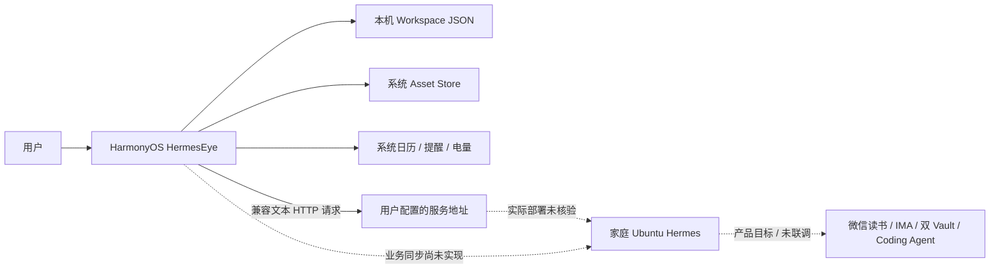
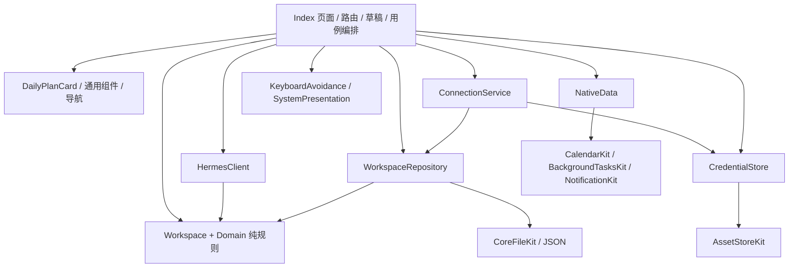
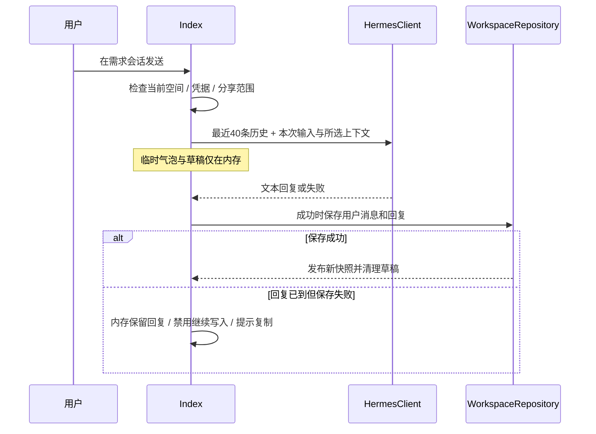
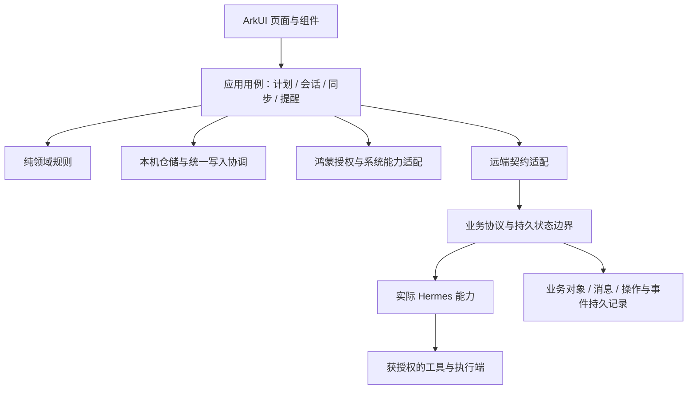
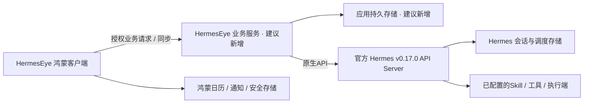

# HermesEye · V1.0 架构设计与后端能力边界

更新：2026-10-06；阶段：A1部署基线确认 / A2共享架构评审。**已确认官方原版Hermes v0.17.0且API Server已启用；总体方向已认可；独立业务服务方案待确认；尚未实机联调。**

范围依据：[08 产品需求](08-product-requirements-V1.0.md) → [09 交互设计](09-frontend-design-V1.0.md)。本轮仅解析代码和更新文档，不修改生产代码、测试、构建配置或交互稿，不连接服务器、不执行 Agent 任务。

## 1. 设计依据与证据等级

基线是本轮读取的工作目录（HEAD `ed6e4a3` 加既有未提交修改），不是仅该 commit。包含问题8的平台异常处理新增服务。后续代码变化须重新核对受影响结论。

- **代码事实**：可由下文源码和符号直接核对；不代表真实设备或后端验收。
- **产品要求**：08 中全部 V1.0 范围继续有效，未接入不等于移出首版。
- **已确认方向**：用户认可客户端/服务端逻辑分工、原生优先与缺口再补适配的方向。具体字段、协议选择、独立服务部署及新增行为仍需逐阶段评审。
- **后端证据**：用户确认官方原版v0.17.0且API Server已启用；按对应官方发布标签核验源码，见第11节。启用事实来自用户说明；网络可达性、profile、反向代理和实际响应尚未联调，不将已启用等同于业务验收通过。

第2～6节描述客户端现状；第7节为A0需求矩阵，其“待核验”项由第11节的版本证据补充。现在可以区分官方已存在的接口与应用所需保证，但尚不能确认用户部署已具备对应能力。部署核验前不冻结接入路径与拓扑。

## 2. 当前系统上下文与部署

工程采用 ArkTS、ArkUI、Stage 模型，目标 HarmonyOS 6.1.1/API 24；EntryAbility 加载单一 `pages/Index`。四入口与详情页通过组件内 `tab/route/history` 编排，不是多个独立 Ability。网络目标计划通过 Tailscale 到家庭 Ubuntu；可达性、TLS 与实际网关均未在本轮验证。Obsidian 插件的文件同步不是 HermesEye 业务同步。

## 3. 当前逻辑分层

| 模块及源码 | 实际职责与边界 |
|---|---|
| [Index.ets](../entry/src/main/ets/pages/Index.ets) | 页面状态、路由、表单草稿、保存锁、消息发送、凭据读取、日历导入、提醒补偿均集中在此；当前没有独立应用用例层 |
| [Workspace.ts](../entry/src/main/ets/core/Workspace.ts) | 工作区实体、关联、迁移、校验、计划规则、记录汇总；不调用平台或网络 |
| [Domain.ts](../entry/src/main/ets/core/Domain.ts) | URL/文本校验、分享上下文、兼容聊天请求/响应和旧数据规则；不是后端业务协议 |
| [WorkspaceRepository.ets](../entry/src/main/ets/services/WorkspaceRepository.ets) | 整体工作区 JSON 读取、校验和原子替换；无数据库、操作日志或同步队列 |
| [ConnectionService.ets](../entry/src/main/ets/services/ConnectionService.ets) / [CredentialStore.ets](../entry/src/main/ets/services/CredentialStore.ets) | 连接与凭据保存协调；凭据使用不可变别名写 Asset Store |
| [HermesClient.ets](../entry/src/main/ets/services/HermesClient.ets) | 单个活动 HTTP 请求、模型列表检测、非流式文本回复、停止本机等待 |
| [NativeData.ets](../entry/src/main/ets/services/NativeData.ets) | 按日读取日历实例、电量/时间快照、系统普通提醒注册与取消；没有健康数据适配器 |
| [IntegrationCapabilities.ets](../entry/src/main/ets/services/IntegrationCapabilities.ets) | 静态列出未接入能力；不是运行时能力协商或服务发现 |
| [PlatformErrors.ets](../entry/src/main/ets/services/PlatformErrors.ets) | SDK 操作阶段和数值错误码；脱敏错误诊断 |
| [SystemPresentation.ets](../entry/src/main/ets/services/SystemPresentation.ets) / [KeyboardAvoidance.ets](../entry/src/main/ets/services/KeyboardAvoidance.ets) | Toast、主题、窗口键盘监听与异常边界 |
| [Repository.ets](../entry/src/main/ets/services/Repository.ets) | 旧格式仓储；当前 Index 使用 WorkspaceRepository，旧文件由后者读取迁移 |

## 4. 数据模型、身份与所有权

### 4.1 当前聚合

`Workspace(version=2)` 包含外观、一个当前 Connection、activeServer 和多个 Space。Connection 含地址、模型、自动连接开关及 credentialRef；Token 不在业务 JSON 中。

| 实体 | 当前语义 | 对后端集成的限制 |
|---|---|---|
| Space | serverKey 下的项目、需求、计划、记录、书籍、运行、提醒及 lastSyncAt | 无用户主体、远端 workspaceId 或同步游标 |
| Project | 名称、目标、manual/agent 托管标记、下一步 | 托管标记不构成 Vault 写权限或执行授权 |
| Need | 稳定本机 ID、归属、创建时间、内嵌 messages | 无远端会话 ID；一个 Need 内直接保存一个消息序列 |
| Message | role、content | 无 messageId、时间、发送状态、服务端确认与去重键 |
| NeedLink | 原始事项 → needId | 会话移入项目后保留来源链接，不复制历史 |
| PlanItem | 日期、状态、项目、可选重要性/用时/说明/建议来源/日历快照 | 无 revision、删除墓碑、远端更新来源 |
| IntervalRecord | 事件区间、完成/未完成、精力自述、决策、新待办、补记 | 没有经确认的周期策略；不能推断记录覆盖率 |
| ReadingItem | 阅读进度和各项计数、来源/更新时间、摘抄/总结 | 有显示模型，无真实采集链路；null 表示尚未获取 |
| AgentRun / RunEvent | 关联需求、状态、事件、成果字符串、部署字符串 | 有展示容器，无事件接收、序号续传或结构化部署回执 |
| Task | 系统提醒时间、工作日开关、设备 reminderId | 是设备注册记录，不是远端 Agent 任务 |

`serverKey = connectionUrl(connection)`，按协议、主机、端口和 API 基础路径隔离。连接规范化主机、校验端口并补 `/v1`；不支持 IPv6 主机表示。当前只保存一个连接配置，历史空间数据保留，但不是完整的多连接凭据管理。

**身份风险（代码推导）**：同地址更换 Token/账号仍选中同一 Space；同一后端改地址可能产生不同 Space。因此当前地址隔离不能直接扩展为多用户隔离。以后需要服务端稳定身份与认证主体映射，迁移归并必须显式确认，不能按地址相似自动合并。

### 4.2 保存与迁移

常规本机变更：`copyWorkspace → 应用当前空间规则 → validateWorkspace → repository.save → 发布 @State`。页面 busy 锁阻止当前页面用例重复提交，但仓储本身没有跨进程/多写入者事务控制。

保存写 `.tmp`，处理短写，fsync，关闭后 rename 替换。加载失败会禁用写入；新文件损坏不会退回旧文件覆盖。首次缺少 v2 文件才读取并校验 v1，迁移全局会话为独立需求，记录与提醒进入 local，旧文件保留。历史地址可恢复但旧内存 Token 不可恢复；迁移数据不自动分享。

普通业务文件没有应用层加密实现；不能因为 Token 在安全存储，就声称日历与聊天正文也在安全存储。工程存在备份扩展源码和 `allowToBackupRestore=true` 配置，但当前 module.json5 未声明该备份扩展，不能据此声称已有可用备份链路。实际备份纳入范围、Asset 可迁移性和恢复后凭据重新绑定均待设备核验。

整快照复制/校验/同步文件 I/O 成本随全部历史增长；当前没有分页、压缩、保留策略或性能规模指标。若引入后台同步，应先设计统一写入协调，再决定是否升级存储引擎。

## 5. 当前关键流程和失败语义

### 5.1 启动、连接与凭据

启动先加载工作区，再读取安全凭据；已启用 autoConnect 且处于匹配空间才做检测。安全凭据失败不阻断本机数据浏览。

保存连接先验证地址，新增安全别名，再写配置；写配置失败尝试移除新别名，旧配置/凭据仍有效。成功后尝试清理旧别名，失败留下未引用安全资产并记录脱敏诊断。这是补偿协调，不是文件与 Asset Store 的跨系统原子事务。

“测试当前输入”“保存配置”“连接已保存配置”分开。检测成功不更新 lastSyncAt，不自动发送任务。

### 5.2 需求会话发送

传输失败保留输入，不在正式历史中追加成功消息。回复已到但落盘失败是常规“失败不发布快照”的特例：发布仅内存快照并设置 ready=false，防止用户误重发。进程退出后没有可靠回复恢复能力。

发送只含 model/messages/stream，**不发送 needId、ownerId、会话 ID、消息 ID 或幂等键**；客户端无法据此证明远端需求隔离、持久会话恢复或安全重放。最近40条是消息条数截断，不是 token 预算。虽然 Domain 保留旧历史上限，当前页面先 slice(-40)，没有把完整 V1.0 历史限制为40条。

当次可选择今日日历、设备状态及同空间另一会话最近6条；系统快照超过10分钟或时间异常会拒绝分享。分享上下文会嵌入用户消息并落盘，所以后续40条历史可能再次带出此前分享的数据；取消本次选择不会撤回已发送数据，也不会清除历史中的内容。需要用户确认未来撤回/脱敏策略。

“停止等待”销毁本机请求并拒收迟到响应，不能取消后端工具、副作用或部署。无运行查询接口时超时后的服务端状态未知，不应显示执行失败或自动重试。

### 5.3 每日计划、日历与提醒

计划日期/状态/采纳均由本机规则处理。建议来自前7个自然日的未完成计划与记录 nextTodo，非 AI。采纳创建新事项、保留来源；移除计划保留会话，必要时转为独立需求。事务统计排除日历事项，日历占用只计算已导入非全天快照并合并重叠。详见 [11](modules/11-daily-plan-spec.md)。

日历只在主动读取时申请权限，按设备当地自然日查询；实例 key 为日历ID/事件ID/实例起始时间。导入是快照，不回写系统日历，也不自动跟随日历变化。当前空间按 key 去重不代表跨设备或跨日历源的业务去重。

提醒先注册系统、再保存本机；保存失败尝试撤销。取消先调用系统、再删除本机条目；落盘失败可能保留一个系统已取消的条目，重新取消可处理已不存在状态。进程在两步间退出的恢复对账尚未实现。提醒只打开 EntryAbility，未实现计划页冷/热启动直达；工作日指周一至周五，不含节假日历。

## 6. 当前 HTTP 契约：客户端预期，不是服务端能力证明

| 项目 | 源码实际行为 |
|---|---|
| 地址 | apiBase 校验并补 `/v1`；默认 HTTPS；显式开启后允许指定内网/回环/Tailscale IPv4 范围 HTTP |
| 鉴权 | Authorization Bearer Token；禁止自动重定向，无自动重试代码 |
| 检测 | GET 基础地址 + `/models`；要求200且 JSON.data 为数组；不验证所选模型是否存在，也不做业务能力协商 |
| 对话 | POST 基础地址 + `/chat/completions`；model、messages、stream=false |
| 成功解析 | 2xx、合法 JSON、choices[0].message.content 为非空文本；最大32000字符 |
| 网络限额 | 连接超时10秒、读取超时60秒、响应上限1 MiB、禁用缓存 |
| 不支持的客户端协议 | SSE/事件续传、工具调用结构、持久会话、任务控制、增量同步、上传附件、结构化成果回执 |

即使目标提供相同路径，也必须检查它究竟执行 Agent 还是仅返回模型文本、是否持久化、如何授权工具、客户端超时后是否继续运行。`/models` 通过最多证明该次检测满足客户端形状，不证明这些业务能力。

## 7. V1.0 能力与后端核验矩阵

下表“所需契约”是需求，不是自创 HTTP 端点；后端原生/插件/自建适配的归属须在取得实际源码后填写。

| 需求 | 当前客户端 | 后端或系统必须核验的能力 | 未核验前的边界 |
|---|---|---|---|
| H01–H05 入口与需求 | 本机项目、需求、关联会话 | 稳定业务身份和需求归属映射 | 不宣称远端共享归属 |
| C01–C03 连接凭据 | 地址、检测、安全保存已实现 | 部署入口、Token 主体与权限、轮换/撤销 | 只展示检测状态 |
| C04 持久会话 | 本机消息历史 | session/message稳定ID、分页、落盘及重启恢复 | 兼容文本上下文不能替代恢复 |
| C05–C07 同步 | 多空间副本，无同步实现 | 版本、游标、冲突、删除、全量重建 | lastSyncAt 保持未同步 |
| P01/P02/P05 计划日历 | 本机编辑、导入和统计 | 计划/日历来源的同步映射 | 本机状态有效，远端状态未知 |
| P04 个性化建议 | 本机历史规则 | 经授权来源、结构化候选、依据、采纳幂等 | 不伪造 AI 建议 |
| P03/E01–E05 提醒日报 | 普通提醒、区间记录、非AI汇总 | 调度持久化、时区/漏跑策略；设备通知权限及直达 | 不承诺周期自动化或强提醒达成 |
| R01–R05 阅读 | 阅读数据模型/缺失态 | 实际 Skill、字段/计数、来源引用、增量采集、IMA写入回执 | 缺失保留null，不填零冒充 |
| B01–B04/B09 知识项目 | 本机项目/托管标记/选定会话引用 | Vault映射、读取/写入权限、版本与成果确认 | 文本托管标记不授予服务器文件权限 |
| B05–B07 Agent与部署 | 运行展示模型，无执行适配 | 运行ID、工具授权、事件/状态查询、幂等、成果及部署回执 | 回复文本不能改变真实执行状态 |
| B08 财务项目 | 可作为普通项目组织 | 具体数据源与分析需求仍待细化 | 不推导交易能力或授权 |
| D01–D04 手机数据 | 日历/电量主动读取和当次分享 | 健康开放资格、数据项、后台限制、独立自动化授权 | 不直接访问其他应用私有数据 |

后端核验材料：实际仓库URL及commit/部署版本、启动模式与启用组件、网关契约、认证主体模型、会话存储/调度/工具配置的脱敏说明。先读源码和文档，随后另行安排只读能力检测与授权联调；不索取 Token 写入文档。

## 8. 目标架构（方向已确认，细化方案待评审）

### 8.1 职责安排与方案选择

已获用户认可：“鸿蒙本地交互与副本 + 服务端业务事实与执行 + Hermes能力适配”的逻辑分工；是否新增独立服务由核验结果决定。

这张图是逻辑职责图，**不表示当前已有这些组件，也不要求增加所有部署进程**。

| 可选方案 | 适用条件 | 代价与建议 |
|---|---|---|
| 直接接 Hermes 原生业务API | 部署版本已提供所需持久身份、同步、运行契约 | 优先复用，客户端做映射与版本兼容 |
| Hermes 扩展或旁路业务服务 | Hermes 能执行工具，但缺少应用所需业务协议 | 建议条件方案；需要维护持久化、鉴权、幂等及升级兼容，不只是转发聊天 |
| 仅兼容文本 | 暂时只确认 chat completions | 可维持现状，但无法据此验收完整 V1.0；不能作为最终架构替代前两者 |

将 Index 中的用例逐步移到应用层，是未来实施建议；本轮不重构。工具凭据与操作权限在服务端执行边界管理；手机只提交业务意图和明确授权，不直接编排服务器文件操作。

### 8.2 所需领域契约（字段为语义示例，名称待映射）

| 契约 | 最低语义 |
|---|---|
| 身份与能力 | 稳定serverId、认证主体、workspaceId、协议版本、逐项能力及权限；不以网络地址作唯一身份 |
| 对象同步 | entityId、revision/baseRevision、origin、更新时间、删除墓碑；服务端返回确认修订 |
| 同步页 | 游标、分页、快照边界、游标失效后的全量重建；不得清空未确认的本机操作 |
| 会话 | needId与远端sessionId映射、稳定messageId/clientMessageId、角色/正文/时间、分页和确认状态 |
| 副作用命令 | operationId/幂等键、目标对象与修订、授权记录、受理结果、原操作查询；重复提交返回同一操作 |
| 运行事件 | runId、稳定eventId/递增序号、明确状态、错误/阻塞、保留期限、断线补发和快照恢复 |
| 成果与部署 | artifactId、来源runId、类型与可访问引用、检查结果；部署目标/版本/审批/真实回执及可用回滚策略 |
| 建议与知识 | 来源引用/版本/授权范围、生成时间、来源缺失状态、用户采纳记录；外部写入可查询回执 |

不能直接拿当前 AgentRun.status 的任意字符串作为协议状态机。建议运行区分已受理、运行中、等待授权、成功、失败、取消；“客户端连接中断/结果未知”属于观察状态，不覆盖服务端事实。取消请求已发出也不等于执行已取消。

### 8.3 一致性与离线策略

建议服务端作为已确认的共享业务事实来源；本机保存可浏览副本及尚未确认的本机意图。手机系统日历、通知注册和本机草稿保持设备归属；导入日历只上传用户同意的最小快照，不同步设备 reminderId。

未来上传分开处理“业务对象编辑”和“有副作用的执行命令”：前者需要持久待提交记录、版本冲突处理，后者必须在持久受理/幂等/查询契约成立后才能考虑恢复提交；不改变当前禁止盲目自动重试的规则。

建议编辑冲突保留本机与远端差异，由用户选择；不按设备时间静默覆盖。删除通过墓碑传播，明确删除计划对 NeedLink 和会话的影响。服务端同步成功须以确认游标/修订为依据，不能仅写一个本机当前时间。时区、自然日归属及跨设备日历实例标识需要单独对齐。

v2 到后续模型的迁移须保留旧文件或可恢复副本、显式版本升级、校验新旧关联和重复操作；不能把字段补齐过程当作已同步。是否改用数据库取决于数据量、分页和并发写入需求的测量，本轮不预选实现。

### 8.4 授权、安全与可观测性

继续保留读取、当次分享、周期自动化三种授权边界。服务端必须校验用户/空间/工具权限，模型提示词和 personal_context 标签不能充当访问控制。Agent工具操作可能产生副作用，部署、跨Vault写入等授权策略要在服务端可审计、可撤销。

手工Vault与AgentVault的路径和写入政策需独立配置；成果写入、覆盖、部署分别确认，不能由项目 managedBy 字符串自动授予全部权限。跨需求引用要保存来源和共享范围，不默认共享全空间。

建议未来诊断贯通 requestId/operationId/runId 和失败阶段，不记录 Token、日历正文、健康/财务内容或完整聊天。当前只存在本机平台诊断和文本错误；没有端到端指标、运行审计或恢复对账任务。

## 9. 架构风险与验证门槛

| 风险 | 当前证据 | 进入对应阶段前的门槛 |
|---|---|---|
| 前端规划超出真实后端 | 仓库只有兼容文本客户端 | 固定部署版本，逐项填原生/扩展/缺失及证据 |
| 跨账号数据混用 | Space按地址，无认证主体 | 同地址换账号隔离、地址变更迁移评审 |
| 重复执行/未知执行结果 | 无operationId、只停止网络 | 受理后断线、超时、重复提交、服务器重启的原运行查询 |
| 本机/远端消息不一致 | 无稳定消息ID、成功后才落盘 | 发送前持久意图、消息确认、落盘失败恢复，不重复执行 |
| 同步误覆盖与删除丢失 | 无revision/墓碑/游标 | 双客户端并发、离线编辑、删除冲突、游标失效恢复 |
| 运行或部署状态虚报 | 只有展示模型 | 实际执行事件与可验证成果回执，取消/权限撤销验证 |
| 日历和提醒跨设备失真 | 本机实例ID/提醒ID | 日历跨日/来源验证、通知冷热启动及提醒注册对账 |
| 大历史卡顿 | 整快照复制与同步I/O | 明确数据规模、耗时/内存指标后决定存储演进 |
| 授权范围被历史重发扩大 | 分享数据写进历史 | 确认历史重发/撤回语义及最小化策略 |

已有问题8证据记录：7/7流水线、96组Node、9项Previewer、5项模拟器测试，见 [05](05-release.md) 和 [最终摘要](testing/validation/2026-10-06-issue8-final/summary.json)。这是既有批次结果，不是本轮重跑，也不证明本次架构方案或真实后端已验收。

本轮只做源码、既有规格/证据和文档一致性检查；未运行构建、测试、设备或网络联调。后续实现仍按 [04](testing/04-test-plan.md) 的门禁和 [10](testing/10-test_record.md) 的问题记录执行。

## 10. 需求阶段交付与确认机制

遵照2026-10-06用户要求：当前任务只做架构解析、设计、需求确认和文档调整，未经后续明确实施要求不改代码。每个需求阶段结束均形成完整设计，不只追加聊天摘要。

每阶段文档必须包含：需求与范围、用户确认状态、当前实现基线、后端版本与证据、方案比较及选择理由、系统/模块边界、数据与接口、关键流程、异常/恢复/安全、迁移与兼容、验收标准、待办与未验证范围。本文维护当前架构；阶段记录保留结论及替代原因，模块细化同步对应规格。后端缺口不得悄悄删减V1.0需求。

| 阶段 | 完整交付目标 | 当前状态 |
|---|---|---|
| A0 当前解析 | 当前结构、数据/调用链、后端缺口、目标方案和确认项 | 架构方向已获用户认可；具体契约继续评审 |
| A1 后端契约核验 | 实际版本/部署拓扑、源码/文档证据、能力矩阵、原生与扩展方案、协议及失败契约 | 官方原版与API Server启用已确认；源码初核完成，实机契约仍待联调 |
| A2 共享基础架构 | 身份/会话/同步/幂等/运行/授权的完整设计与迁移验收 | 第12节形成共享架构评审稿；待确认独立业务服务，不冻结线协议 |
| A3 按用户需求逐模块 | 每日计划、周期日报、阅读知识、Agent执行等逐轮完整设计 | 顺序由用户需求驱动，持续确认 |

### A0 · 2026-10-06 阶段记录（保留首次评审状态，后续确认见第11节）

用户明确要求：系统架构师职责；只解析代码；考虑Hermes后端真实边界；先更新架构文档；每阶段与用户确认并沉淀完整设计。

本轮结论：现有架构是本机工作区加非流式兼容文本客户端，已建立平台适配和纯规则分层，但用例仍集中Index。阅读/运行存在模型而无接入；当前无后端能力证据，不声称后端不具备这些能力。

建议及理由：先核验后端，再优先复用原生协议，必要时增加业务适配边界；共享身份/会话/同步/执行事实应先于进一步依赖这些能力的页面细化，减少返工。此为待确认方案，没有新增接口或改变代码。

待用户确认：①是否认可第8节逻辑分工及“原生优先，缺口再补适配服务”；②是否按A1→A2→模块设计推进；③提供实际Hermes仓库/版本/网关资料。前两项是新增设计建议，不能视为用户已批准；既有四入口与V1.0范围不重复确认。

变更：重写本架构文档，补充每日计划的后端约束与讨论记录。未调整页面/交互稿或代码；无新增设备验收状态。后续收到后端资料后补齐A1，明确每项约束是“未公开、未启用、可扩展或确实不支持”，再确认实现路径。

## 11. A1 · Hermes v0.17.0 后端核验与架构细化

### 11.1 用户确认与版本基线

2026-10-06用户回复“认可该方向”，并指定Hermes版本v0.17.0。A0逻辑分工及原生优先原则转为已确认；不将此认可扩大为批准具体API设计、部署新服务或修改代码。

官方 [发布记录](https://github.com/NousResearch/hermes-agent/releases/tag/v2026.6.19) 将v0.17.0对应到标签v2026.6.19、提交短号2bd1977。本轮固定该标签读取源码，不引用main分支的新能力。用户后续明确确认使用官方原版且已启用API Server，因此本节作为版本接入基线；这仍不是家庭服务器实测验收。

### 11.2 官方代码事实摘要

[API Server源码](https://github.com/NousResearch/hermes-agent/blob/v2026.6.19/gateway/platforms/api_server.py) 已有能力发现、会话、异步运行、审批、停止和定时任务路由。关键定位：`_handle_capabilities`、`connect`、`_handle_runs`、`_handle_run_events`、`_handle_stop_run`。其运行状态/事件队列在内存，事件消费后清理；停止返回stopping。`_IdempotencyCache`为300秒内存缓存，不能保证跨重启去重。jobs_admin声明为false但存在jobs路由，需实测澄清。

| 官方入口 | 用途 |
|---|---|
| GET /v1/capabilities | 能力发现 |
| /api/sessions | 会话资源、消息、chat及stream |
| /v1/runs | 异步提交、查询、events、approval、stop |
| /api/jobs | 定时任务管理 |

以上路径需按实际反向代理前缀映射；不是本轮发明的接口。具体请求/响应及错误映射待下一步契约设计。

[SessionDB源码](https://github.com/NousResearch/hermes-agent/blob/v2026.6.19/hermes_state.py) 的sessions/messages表保存会话、父子关系及带ID/时间的消息，说明官方已有持久会话基础。需要另验压缩轮换后的身份映射、并发写入和部署磁盘持久性，不能将“有数据库”等同于恢复验收完成。

[调度器源码](https://github.com/NousResearch/hermes-agent/blob/v2026.6.19/cron/scheduler.py) 的run_one_job负责执行、保存输出、投递和记录结果；tick使用锁并先推进调度时间。由此应分别记录“任务执行”和“结果送达”，补跑/重复执行策略仍须专项验证。调度器不能替代鸿蒙设备通知能力。

官方 [发布说明](https://github.com/NousResearch/hermes-agent/releases/tag/v2026.6.19) 也列出后台子Agent、自动化蓝图和远程桌面网关能力。它们说明有复用基础，但不是HermesEye的多Agent事件、阅读Skill或部署回执契约证明。

### 11.3 对A0的修正与架构安排（推导及建议）

本节取代A0“后端全部未知”的状态，不改变第2～6节客户端现状。需要区分：客户端没有接入、官方已有实现、部署已启用、业务保证满足四个层次。

| 边界 | 本轮架构安排 | 尚待核验 |
|---|---|---|
| 会话与消息 | 优先让Hermes持有Agent会话，业务层保存Need到远端会话的映射；避免再造一套推理历史 | 会话轮换、分页/全量读取成本、同会话并发和重启恢复 |
| 运行控制 | 优先复用原生运行机制；本机断开等待与请求后端停止分开设计 | stop后的工具实际状态、超时受理查询、审批作用域 |
| 业务同步 | 计划、项目、阅读统计和归属仍需应用业务契约，不能把会话资源当通用同步 | 本次所读API与数据库未证明存在这些对象的revision/墓碑协议；不据此断言整个项目绝无扩展 |
| 恢复与幂等 | 评估持久操作账本和事件归档；不是简单转发代理 | 上游受理但适配层未存runId的崩溃窗口，需上游可查询关联或扩展支持 |
| 调度 | 优先复用Hermes调度执行，业务层维护业务日期/来源/结果关联 | 时区、漏跑、重复投递、权限撤销及jobs能力声明差异 |
| 多Agent与成果 | 复用执行端，不从自然语言生成假状态；事件拓扑和成果回执单独设计 | API输出能否覆盖子Agent全过程、首批Coding Agent适配及部署验收 |
| 阅读与知识 | 继续按Skill/数据源适配，业务层维护来源与统计语义 | 微信读书、IMA、双Vault是否安装/配置，字段与权限 |

建议目标关系：HermesEye → 业务协议边界 → Hermes原生API；业务协议边界管理应用对象、授权映射和恢复记录。它可以先是逻辑模块，只有缺口确认后才决定独立部署。手机不直接写Hermes数据库，也不把计划硬塞入聊天文本作为唯一事实源。

现有客户端apiBase强制补/v1，而会话资源使用/api路径；未来连接设计应区分服务根地址与端点族，不能将/api/sessions拼到/v1后。现有40条历史兼容模式与服务器持久会话模式需明确切换策略，防止重复注入历史；本轮不改连接表单或发送代码。

特别限制：增加本机或旁路账本本身不能保证“恰好执行一次”。若发送上游后尚未持久化回执即崩溃，必须能按稳定关联查回原请求，否则标记结果未知并人工核对，禁止自动重新执行。

### 11.4 拟议数据/流程与迁移约束

以下延续第8节，属于设计候选，尚未冻结字段名：

- Need保留本机业务ID，新增远端会话映射和映射版本；压缩或恢复导致会话变化时维护关联，不复制为另一个业务需求。
- 操作记录区分本机待提交、已受理、执行中、等待授权、终态及结果未知；runId仅作为远端引用，不能替代业务操作ID。
- 计划/阅读对象与Agent会话各自维护确认状态；拉到聊天历史不意味着全部业务对象同步完成。
- 发送前保存本机意图；网络恢复后先查询已有回执与历史，再决定是否允许用户重发。仅有内存缓存的接口不纳入跨重启自动重试策略。
- v2历史先保留原副本；后续明确选择新建远端会话还是关联已有会话，不按同名标题自动合并，不自动批量上传私人历史。
- 自动日报任务的运行结果进入业务收件与结果确认流程；生成成功、写入知识库成功、手机通知送达分开记录。

### 11.5 部署核验与验收门槛

官方原版及API Server启用情况已由用户确认，不再重复询问。联调阶段仍需核实飞书Gateway与API Server的profile关系、代理前缀及持久数据目录。无需提供密钥、完整配置或私人聊天。

下一步只读核验可检查版本/能力与一份脱敏接口形状；创建会话、任务、执行工具或重启服务器属于另外的联调工作，本轮未进行。

| 验收主题 | 设计通过条件 |
|---|---|
| 身份 | Need映射稳定，账号/profile/服务器切换不混用数据 |
| 会话 | 两客户端恢复同一会话，压缩轮换可追踪，重启后已确认消息可读 |
| 运行 | 受理后断网不自动重复执行；恢复能查询原运行或明确未知 |
| 事件 | 断线/服务重启的缺口可识别；只有持久续传证据才声明完整恢复 |
| 调度 | 明确时区、停机漏跑、重复提交、执行成功与投递失败的行为 |
| 业务同步 | 双端并发、离线变更、删除和冲突不会静默丢失 |
| 平台与集成 | 通知/日历/健康及真实Skill分别验收，不由后端版本替代 |

### 11.6 阶段结论与待确认

A1首轮静态核验完成，部署核验和完整接口契约尚未完成。已确认的是总方向和用户版本；本轮新增建议是复用原生会话/运行/调度，把业务对象同步及可靠恢复作为重点补齐边界。部署独立适配服务仍待证据和用户评审。

本轮仅更新本文及每日计划规格/记录。读取了官方发布及固定标签源码，未修改代码、安装服务、运行构建/测试、访问家庭服务器或执行后端任务。后续用户已确认官方原版及API Server启用，补充设计见第12节；仅保留代理、profile和实际能力响应等待联调，不重复请求认可已确认的总体方向。

## 12. A2 · 共享架构评审稿：官方API Server接入

日期：2026-10-06。输入：用户确认官方原版Hermes v0.17.0，API Server已启用。延续只做设计、不改代码的要求。本节形成共享架构阶段的完整评审稿；不是实现规格冻结或验收结论。第8节通用原则继续适用，具体部署建议以本节为准。

### 12.1 本轮决策范围及接口约束

已确认：后端发行版与API Server可作为集成基线，不需要先设计自建聊天网关。待确认：新增HermesEye业务服务，并将其作为手机的统一业务入口；不修改官方Hermes源码。

补充源码定位：[APIServerAdapter](https://github.com/NousResearch/hermes-agent/blob/v2026.6.19/gateway/platforms/api_server.py) 的`_parse_session_key_header`区分长期记忆scope与会话ID；`_check_auth`校验实例API Key，不能直接当成逐对象用户授权。`_handle_runs`从请求历史或previous_response_id组装上下文，不能仅因传了session_id就认定与session chat的历史加载语义相同。实现前须逐路径核对，禁止把不同端点混为同一种发送方式。

因此建议：先明确每类操作的历史来源、授权范围和确认回执，再映射端点；不以“API存在”为理由立即替换当前发送逻辑。初期使用一个个人业务主体，仍保留服务器/profile边界；这是面向当前个人产品的设计建议，不是引入多人账户产品需求。

### 12.2 部署方案比较与推荐

| 方案 | 能解决的问题 | 代价或缺口 |
|---|---|---|
| 手机全部直连原生API | 会话与运行接入较短 | 仍需另外解决计划等业务对象共享、持续采集、手机离线期间的状态保留 |
| 修改Hermes核心 | 可在内部提交链路增加持久保证 | 跟随官方升级需要维护改动；与当前官方原版运维方式有额外耦合 |
| **同机独立HermesEye业务服务（推荐）** | 统一应用数据、身份映射、操作状态、事件采集和多端接口；复用官方执行 | 多一个需备份、升级和监控的服务；上游未提供的恢复保证仍不能凭空补齐 |

业务服务建议与Hermes同机独立进程，内部调用实际配置的API地址；不固定端口、技术框架和数据库产品。部署实施另需明确服务自启动、存储目录、备份恢复和版本升级策略。本轮不安装或启动服务。

### 12.3 职责及数据所有权

| 边界 | 持有的事实 | 不承担的职责 |
|---|---|---|
| 鸿蒙客户端 | 本机未提交意图、可浏览副本、设备日历快照、通知注册和授权交互 | 不在后台扮演可靠远端任务调度器 |
| 业务服务 | 项目/计划/记录/阅读投影、Need归属、远端会话映射、对象修订/墓碑、操作账本、已采集事件、授权记录 | 不重新实现模型推理和通用工具执行 |
| Hermes | Agent会话、工具执行、原生任务及调度事实 | 不默认理解HermesEye实体和页面状态 |
| 系统及外部数据源 | 日历原事件、设备通知、书籍数据、知识库实际写入和部署结果 | 不由模型自然语言代替其真实回执 |

业务服务中的聊天内容仅为检索/展示副本，必须保留远端来源与更新时间；推理历史以经核对的Hermes会话链路为准。不要让业务库和Hermes库各自独立改写同一会话而无对账规则。

### 12.4 逻辑数据契约（设计名称，非已部署字段）

| 对象 | 最低数据与不变量 |
|---|---|
| BackendBinding | 业务服务生成的稳定绑定ID、Hermes部署/profile映射、协议版本；地址可变，Token不作身份ID |
| NeedSessionBinding | workspaceId、needId、远端sessionId及历史映射；需求改名/移入项目不隐式重建会话 |
| BusinessEntity | entityId、类型、revision、删除标志、来源；服务端原子校验baseRevision并提交新修订 |
| ClientMutation | deviceId、mutationId、目标对象、baseRevision、变化内容、处理回执；重复提交返回原结果 |
| Operation | operationId、needId、请求指纹、授权引用、提交阶段、远端runId、执行/观察状态及时间 |
| CapturedEvent | operationId、业务服务本地序号、来源事件及采集时间；本地序号只保证已采集部分有序 |
| SyncCheckpoint | workspaceId、服务端游标、确认时间；对象页和新游标在本机同次事务发布 |
| AutomationBinding | 业务策略ID、远端jobId、时区、来源授权、结果引用；区别执行、落盘、外部写入和通知送达 |

服务端授权校验必须绑定业务主体与workspace。Hermes实例凭据由业务服务安全配置保存，手机保存业务入口凭据；现有手机Hermes Token不自动上传迁移。若最终选择直连过渡模式，必须明确标记连接类型，不能用同一Token无提示跨服务复用。

### 12.5 正常流程与恢复

**计划编辑与同步**：本机持久化待提交变更 → 用户可立即看到待同步状态 → 业务服务校验baseRevision并原子保存对象和回执 → 客户端收到确认后更新副本。版本冲突返回双方版本，保留本机输入；不靠设备时间覆盖。删除以墓碑传播，计划删除仍保留会话。服务端不能把未经分享授权的日历正文自动作为模型上下文。

**会话**：建立或选择Need → 确认远端会话映射 → 使用该路径明确规定的历史来源发起一轮 → 保存远端确认及消息来源。恢复先获取映射和远端历史，处理会话轮换后再发送；不能同时上传40条兼容历史又让另一层重复加载相同历史。

**执行与事件**：业务服务先持久化操作意图 → 提交Hermes → 保存runId → 由一个采集者读取事件并落盘 → 客户端按业务服务游标查看已采集记录。多台手机从业务服务读取，避免把上游事件流当多端可重放日志。采集者断线后的遗漏显式记录，查询最终状态只能恢复当前结果，不能重建已丢失的过程事件。

**停止与授权**：关闭手机等待仅断开展示；请求停止记录单独命令并等待后端状态核对。审批保存展示对象、作用域、用户决定和回执；审批重复/过期不得自动升级为长期许可。具体原生审批粒度和撤销方式作为契约验收项。

**调度与日报**：业务服务关联用户确认的周期策略与原生job，向执行端提供获准的数据范围；执行完成后验证来源和输出结构，再形成可采纳建议或日报记录。手机通知走鸿蒙能力，不以服务器job成功推断用户已收到提醒。

| 故障点 | 设计处理 |
|---|---|
| 本机落盘失败 | 不宣称已保存；保留输入，禁止把未持久意图静默加入自动队列 |
| 已提交但未收到runId | operation标为提交结果未知；禁止自动再提交，先查询或人工核对 |
| 收到runId但事件采集失败 | 保留runId并查询状态；过程标记存在缺口，不伪造时间线 |
| Hermes重启后运行查询404 | 区分已不存在/已过保留期/无法定位；有消息不等于所有副作用已完成 |
| 业务服务重启 | 恢复对象、回执和已采集事件；未明确受理的副作用保持未知，不自动重放 |
| 客户端游标失效 | 重新取业务快照，保留未确认变更并重新检测冲突 |
| 计划同步正常但Agent离线 | 业务编辑继续可用，远端执行显式不可用，两种状态独立 |

可靠性上限：独立业务服务可以保护自己已持久化的事实，不能修复“上游已执行但回执丢失”的所有窗口。若V1.0验收要求跨任意重启的完整执行事件恢复，仍需上游持久提交/事件契约或被验证的扩展方案；该要求保留为阻塞项，不因为当前版本限制而删减。

### 12.6 兼容、迁移与运维

本机v2数据保持可读；后续升级新版本模型，先保留可恢复副本，再生成稳定对象映射。local收件箱不自动上传；已配置服务器空间迁移须明确目标workspace，不能按地址/标题合并。旧文本历史可保持只读归档，如何与新远端会话衔接需用户选择，不批量重发旧消息。

现有连接地址在迁移时拆分服务根与API族，保留代理前缀；业务服务绑定Hermes入口，客户端绑定业务入口。遇到不兼容版本提供本机浏览和明确错误，不静默退回兼容文本发送，否则会绕过操作账本及授权。

服务端备份覆盖业务数据与映射，并与Hermes会话备份协调恢复；凭据独立管理。恢复演练验证对象、会话引用和未完成操作，不以“进程启动成功”作为恢复完成。日志仅保留标识、阶段、脱敏错误，不写Token或正文。

### 12.7 验证与阶段交付

该方案的实施门槛：用户认可独立服务；核对实际只读能力响应及profile/代理路径；确定会话发送和运行发送的历史语义；通过提交未知、事件断线及重启场景的契约测试。架构阶段不执行这些有状态测试。

后续验收沿用第9节和11.5，并增加：同一mutation多次到达只产生一次对象变化；两设备同时改同一计划出现明确冲突；事件缺口可见；凭据轮换不改变业务身份；业务库恢复后不会把未知操作自动重放。具体性能与数据规模指标在选择存储技术前确定，不凭当前小规模用例给出容量承诺。

本轮实际完成：用户部署基线入档、官方代码关键语义复核、职责/数据/流程/异常/迁移/验收设计及模块文档同步。只做文档格式和引用检查；没有代码变更、构建、设备测试、家庭服务器连接或服务安装。

**本轮待确认：是否采用“同台Ubuntu新增独立HermesEye业务服务，保持官方Hermes原版，手机通过业务服务使用会话/执行与业务同步”的具体部署方案。** 如确认，下一阶段细化身份、会话和同步契约；不再重复询问官方版本与API Server启用情况。

## 13. A2 本地实施 · 2026-10-07

用户已明确要求实现，并确认采用“独立业务服务，先本地实现与测试”。此要求取代前文各阶段“本轮仅设计/不改代码”的执行限制；原评审记录保留。当前交付为共享基础架构的可运行本地预览，**不是全部 V1.0 模块完成或家庭服务器验收**。

- `backend/`：Python 标准库 HTTP + SQLite；单进程、单个人空间，独立业务 Token，默认仅监听回环地址。稳定 serverId/workspaceId 保存在数据库，改地址不改身份；换 workspace 配置拒绝打开原库。更换 Token 是同空间轮换，不代表换账号。
- `/eye/v1`：业务对象修订、CAS、删除墓碑、增量分页/快照、持久化去重回执。冲突也保存回执，解决时使用新 mutationId；不以时间覆盖。完整线协议与启动方法见 [业务服务说明](../backend/README.md)。这是本仓库协议，不是官方 Hermes 新接口。
- 持久会话使用官方 `/api/sessions` 和 `/chat`，保存 Need 映射并接受返回的会话轮换 ID；每次仅发送新输入。异步执行单独使用 `/v1/runs`，默认关闭，不宣称 session_id 自动恢复运行历史。
- 操作先落库再请求上游；重复 operationId 返回原记录，内容不同拒绝。提交后断线/未获回执标记 unknown；重启将 submitting 转 unknown，禁止自动重放。未知操作阻塞该 Need 新执行，需人工核对，不提供猜测性“成功”或强制重试按钮。
- 运行采用单采集者归档；事件本地序号可分页读取。重启/中断记录 capture.gap；查询状态失败只改变观察状态，停止请求只记 stopping。审批、调度、成果部署能力明确关闭。
- 客户端新增 `BusinessSync`、`BusinessCoordinator`、`BusinessClient`、`BusinessRepository`：独立副本、持久 outbox、冲突双版本、原操作查询、实体/游标原子保存和旧副本覆盖保护。网络地址与身份分别校验；业务请求不复用 Hermes 直连凭据。
- “我的 → 独立业务服务（本地预览）”提供独立连接、离线查看/新增今日计划、删除、显式同步、冲突选择、持久会话发送与查询。Token 只在该页面内存使用；旧四页与 v2 文件保持原流程，不自动迁移/上传旧历史和私人来源。

### 本地验证与剩余范围

Harness 新增 `logic-business` 与 `backend-service` 两阶段，完整流水线现为 9 阶段。新增测试覆盖跨重启去重、双端冲突、墓碑、分页、身份隔离、HTTP 认证、原生会话映射、未知执行不重放、停止语义，以及客户端落盘失败/游标/outbox 保护。实际最终结果见 [05](05-release.md)。

仍未实现：旧四页全面改走业务服务、v2 显式选择迁移、远端完整历史分页 UI、服务端多用户认证、审批与工具细粒度授权、周期调度、阅读/知识适配和成果部署。服务端项目/记录/阅读仅有基本对象存储，不等同于模块完整交付；计划删除尚不跨业务实体自动改归属。以上保留为 V1.0 待办，不从产品范围删除。

仍未验证：家庭 Ubuntu 部署、真实 Hermes 契约/权限/事件/重启恢复、手机到业务服务的网络连通与完整 UI 流程、真机系统能力。上游请求契约依据固定标签 v2026.6.19 源码；本地测试使用注入实现，不将静态核对写成联调通过。

### 2026-10-07 · 用户补充本机联调配置

实际调试的 Hermes 上游地址为 `http://127.0.0.1:8642`，明确使用 HTTP。业务服务以 `HERMES_ROOT` 配置该根地址，不附加 `/v1`；适配器按接口族拼接路径。用户提供的上游 Token 仅通过 `HERMES_TOKEN` 注入运行进程，不记录具体值，不复用为 `HERMES_EYE_TOKEN`。现有适配器已允许回环 HTTP，无需放宽其他地址的 HTTPS 约束。

此地址指业务服务所在开发机的回环地址，不是手机或模拟器的回环地址。该补充为已确认配置，尚不代表端口连通、认证或真实会话/运行已验收；后续本机联调使用该配置，家庭 Ubuntu 部署仍另行安排。

### 2026-10-07 · 真实本机链路验证增量

用户随后要求实际联调，已验证开发机业务HTTP → 生产适配器 → `http://127.0.0.1:8642` 的认证、能力/模型读取、原生会话两轮上下文、操作去重及新业务进程恢复原账本。第一轮2.69秒，第二轮1.14秒，同一会话4条消息；重复提交没有新增远端消息。测试无工具消息，详细证据与限制见 [05真实联调记录](05-release.md#2026-10-07--真实-hermes-本机联调)。此结果更新前述“本机真实会话未验证”状态；不扩展为手机网络、Hermes进程重启、run/事件/审批/调度或工具权限已验收。
