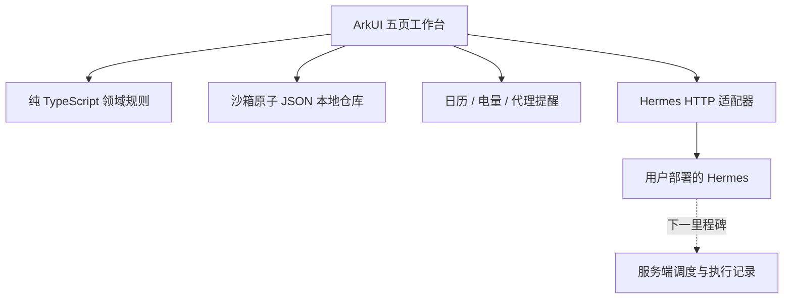

# HermesEye · 架构与决策

## 分层

客户端以界面组件持有状态，服务层隔离系统 API；规则用平台无关 TypeScript 编写，可在本机 Node 下测试同一份生产代码。本地 JSON 写入临时文件、fsync 后重命名替换原文件，避免 Preferences 单值容量限制。文件位于应用沙箱，不额外声明存储权限；当前明文沙箱存储，后续敏感数据加密及数据增长时迁移 RDB（版本化迁移、事务、查询索引）。Token 不持久化，既不放日志，也不进入备份。设置保存与聊天发送相互隔离。

## 接口假设（待真实部署确认）
根据 NousResearch Hermes 官方 API 文档，采用 Bearer 认证和 `POST /v1/chat/completions`，`stream:false`，`messages` 包含完整本地历史；连接检测使用 `GET /v1/models`。地址支持含 `/v1` 的基础路径。此接口选择不代表已识别用户的 Hermes 实例。

请求中的上下文以明确标记的用户数据块附加到当前用户消息，仅当用户本次选中时加入。历史中保留实际发送的快照，因此后续多轮仍可能携带历史已分享内容；页面应提示，清空会话可停止后续携带。数据被视为参考材料，不能授予模型额外权限。

## 原生能力
Calendar Kit：请求 READ_CALENDAR，读取当日时间范围，最少字段（标题/起止时间），上限 30 条展示；无写日历权限。Basic Services Kit：电量，辅以本地时间。Background Tasks Kit：代理提醒注册与取消；Notification Kit 请求通知授权。日历和电量无后台持续监听。

## 网络与一致性
正式环境 HTTPS；局域网 HTTP 仅明确开关且地址为 loopback 或 RFC1918 IPv4。无重定向信任扩散；禁用自动重试。一次只发一个聊天请求；失败保留原输入，服务端是否执行未知。提醒先发布后保存；保存失败尝试取消补偿，补偿失败给出诊断。取消先调用系统，再移除本地数据。数据加载失败不使用空数据覆盖旧存储。

## 下一里程碑：服务端自动化
不要在协议未确认时伪造 `/tasks` 接口。需依据用户部署实现 SchedulerPort，包含创建/停用/修改/运行记录：taskId、IANA 时区、计划、输入模板、授权数据源、幂等键、下一次执行时间。服务端持久化并定期执行；手机前台同步结果，后台触达需评估华为 Push Kit。离线快照带采集时间/过期时间；过期数据不得伪装为实时数据。远程主动取手机数据需要受控请求队列及前台/系统允许的执行窗口，不能承诺任意后台拉取。

## 参考
- [Hermes 官方 API Server](https://hermes-agent.nousresearch.com/docs/user-guide/features/api-server)
- [华为代理提醒](https://developer.huawei.com/consumer/cn/doc/harmonyos-references/js-apis-reminderagentmanager)
- 编译期签名以本机 DevEco Studio SDK 的 `@ohos.calendarManager.d.ts`、`@ohos.reminderAgentManager.d.ts` 为准。
