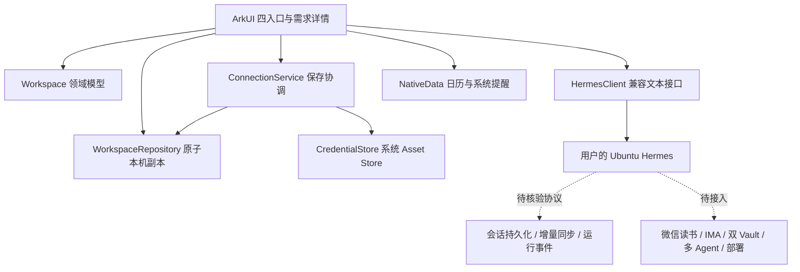

# HermesEye · V1.0 架构与接口边界

更新：2026-10-01。产品范围按 [08](08-product-requirements-V1.0.md)，页面按 [09](09-frontend-design-V1.0.md)。

## 分层

- `core/Workspace.ts`：连接、服务器空间、项目、需求、稳定来源关联、计划、区间记录、书籍、运行事件；校验、迁移与统计为纯 TypeScript。
- `core/Domain.ts`：兼容文本协议、输入/地址校验、分享快照规则及旧格式校验。
- `services/WorkspaceRepository.ets`：version=2 文件；写入临时文件、处理短写、fsync、原子 rename。损坏新文件不回退旧文件覆盖。
- `services/CredentialStore.ets`：Asset Store Kit，设备解锁可访问；Token 不进入业务 JSON。
- `services/ConnectionService.ets`：先校验，写入新的安全别名，再提交配置；配置失败撤销新别名，旧配置和凭据仍有效。成功后尝试移除旧别名，失败只留下未引用的安全资产。
- `services/IntegrationCapabilities.ets`：记录真实集成缺口；不是伪造的 HTTP API。
- `components/WorkspaceComponents.ets`：通用标题、操作组件；`pages/Index.ets` 编排状态和页面。

## 身份与迁移
服务器空间键为规范化协议、域名/IP、端口和 API 基础路径。连接切换产生或恢复独立空间，不混合本机收件箱或其他服务器数据。草稿按服务器隔离，会话草稿另按稳定需求 ID 保存于内存。

项目、计划和书籍可关联需求；`NeedLink` 保留原始事项到会话的链接，移动会话只改变归属，不复制历史。运行按 `needId` 关联，不能从普通回复推断实际执行成功。

首次读取新格式不存在时，验证并迁移 `hermes-eye-v1.json` 到 `hermes-eye-workspace-v2.json`。旧文件保持不动；旧全局会话转为“历史会话（V0.2 迁移）”独立需求；有效地址可恢复，旧版内存 Token 不能恢复。迁移数据保留在 local 空间，跨服务器分享需用户明确操作。

## 当前网络能力
仅核验了现有兼容 `GET /v1/models` 和 `POST /v1/chat/completions` 客户端形状，尚未连接用户真实 Hermes。请求禁用重定向和自动重试。测试/认证成功不会填充 `lastSyncAt`。

本机保存完整历史，兼容发送携带最近 40 条并在 UI 说明；需要服务端会话协议后替换此兼容行为。停止等待释放传输并拒收迟到响应，不表示服务端执行停止。自动连接只做认证读取，不自动执行、部署或重发失败任务。

## 必须核验的服务端契约
以下是待确认的需求，不是已经部署的接口路径：

|能力|所需契约|
|---|---|
|业务身份|服务器稳定 ID、用户作用域、能力与版本协商|
|持久会话|需求/归属/消息稳定 ID、服务端落盘、分页、重启恢复|
|业务同步|增量游标、对象修订、删除标记、确认时间；冲突保留双方，不静默覆盖|
|副作用执行|幂等键、原运行查询、明确授权、超时后查询原状态|
|事件恢复|运行 ID、递增事件游标、断线补发、多 Agent 分工、失败/阻塞原因|
|成果与部署|检查结果、成果引用、真实部署回执、确认和回滚策略|
|阅读与知识|计数口径、原文引用、定时摘要去重、IMA 写入结果、两 Vault 权限|

未确认上述协议前不发明 `/tasks`、`/sync` 或运行控制接口。健康数据须核验开放条件；周期自动读取/分享需独立可撤销授权，当前仅实现主动读取和当次选择。

## 每日计划领域扩展 · 2026-10-03

计划新增可选 priority/minutes/note/suggestionKey/suggestionReason，保持 Workspace version=2 与旧数据兼容。保存校验、自然日移动、历史建议采纳、占用时间合并、移除保留会话在 Workspace.ts；DailyPlanCard 以最新工作区 ID 查询结果驱动 @Prop。NativeData 读取指定自然日，缺省今日。原子快照写入和服务器空间隔离沿用，未引入虚构同步接口。完整数据与协议边界见 [模块规格](modules/11-daily-plan-spec.md)。
