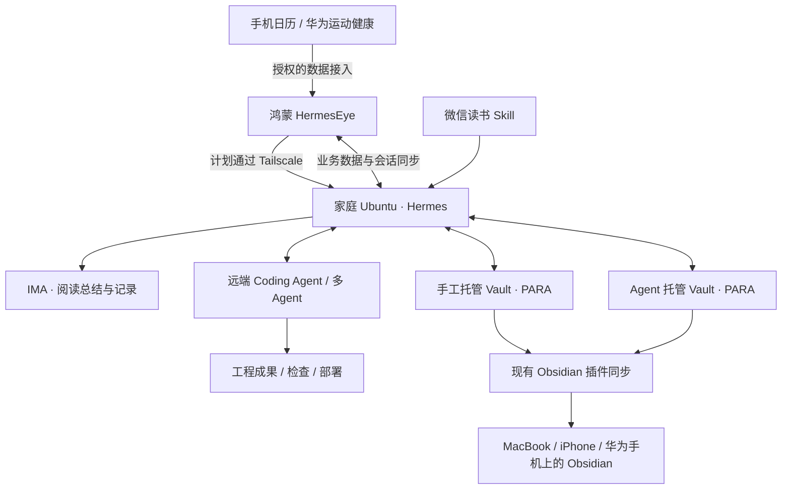

# HermesEye · 痛点与产品需求 V1.0

日期：2026-10-01。状态：用户已确认的 V1.0 范围与页面方向，待开发与联调验收。

本文依据本轮需求讨论整理，是 V1.0 产品范围的依据；不是现有应用能力清单。页面、交互与配色详见 [前端设计 V1.0](09-frontend-design-V1.0.md)。原 [V0.2 需求](history/V0.2/01-product-requirements.md)保留为历史开发预览基线；与本文件冲突的 V1.0 目标以本文件为准。

## 1. 真实场景与痛点

用户希望提高个人效率、定期整理和追踪读书笔记、构建个人第二大脑，并通过手机指挥个人 Agent 推进事务。

当前使用链路：杂项查询与跟踪在 ChatGPT；阅读笔记工作流和定时任务在 WorkBuddy；笔记总结在 IMA；代码工作使用 Codex，主要在电脑上完成；通过飞书向 Hermes 记录某段时间完成的事项，结果保存在本地 Obsidian。记录、查看结果和推进行动分散，飞书中的记录步骤尤其麻烦。

| 编号 | 已确认的痛点 | 影响 | V1.0 对应方向 |
|---|---|---|---|
| P01 | 各种需求与记录没有统一入口 | 频繁切换工具，任务与知识缺乏共同视图 | 用 HermesEye 统一发起需求、追踪进展、接收成果 |
| P02 | 入口依赖外部工具，个人数据与使用方式不够可控 | 难以按个人工作流定制 | 连接自行部署的 Hermes，入口与本地数据可控 |
| P03 | 飞书聊天流以文字交互为主，结构和视觉不足 | 难以快速看清待办、项目状态和阅读进度 | 结构化首页、项目卡片、阅读概览、关联会话 |
| P04 | 记录需要手动输入、截图和搬运内容 | 记录成本高，数据不连续 | 快速记录、周期记录、日历与健康数据联动、微信读书 Skill |
| P05 | 结果藏在对话里，建议难以接到后续行动 | 看过回复却缺少持续推进 | 需求 → 会话 → 任务 → 成果 → 下一步的关联 |
| P06 | 代码实践和 Agent 操作依赖电脑入口 | 手机难以发起工作并持续跟踪 | 远端 Coding Agent / 多 Agent 协作，手机查看过程与部署结果 |
| P07 | 有记录但缺少连续回顾 | 难以量化阅读、事务完成和精力变化，认知积累不清楚 | 阅读统计、精力日报、计划反馈和项目知识沉淀 |

## 2. 产品定位与核心原则

HermesEye 是个人事务的统一入口，完全替代飞书作为 Hermes 的交互入口。核心体验是更方便地记录、更有效地指挥 Hermes，并在首页简单展示事情的进展。

- 工具仍可作为数据源、知识存储或执行端存在；用户从 HermesEye 发起需求、查看状态和继续交互。
- 本地可控指入口与个人数据可控，不要求模型推理完全本地运行。
- 所有会话都从需求出发。计划、项目、书籍和独立需求均可承载会话；无明确目标时也必须建立“漫无目的”会话，不提供无归属的全局聊天。
- 首页用于概览和继续推进，细节放入对应页面；记录入口保持容易触达。
- 自动化第二大脑是关键能力，远端多 Agent、部署、会话恢复和多端同步均在 V1.0 范围内，不能以简化原型为由移出首版。
- 每轮新设计结果均需用户确认。已确认的范围与结构无需重复确认；新增行为、重大调整和待定策略单独评审。

## 3. 部署与数据环境

| 对象 | 用户提供的现状 / 计划 |
|---|---|
| Hermes | 部署在家中局域网的 Ubuntu 服务器 |
| 手机连接 | 计划通过 Tailscale，让鸿蒙设备上的 HermesEye 连接家庭服务器；实际连通性待验证 |
| Obsidian | 服务器上的 Vault 为知识存储的一部分，通过现有插件更新至云端 |
| 现有多端 | MacBook、iPhone、华为手机均安装 Obsidian；不等于已存在对应平台的 HermesEye 客户端 |
| 双 Vault 目标 | 手工托管与 Agent 托管分开部署，两者均采用 PARA |
| 模型 | 允许调用远端模型；数据流向须可理解和控制 |
| 客户端数据 | 本机保留数据副本，拉取远端数据同步；连接 Agent 后更新计划、项目和读书进度 |

Obsidian 插件同步与 HermesEye 业务同步是两条不同链路；不能仅凭 Vault 文件已同步，就认定会话、任务状态和计划已同步。部署图是目标关系，不代表接口已打通。

## 4. V1.0 需求与验收目标

以下全部属于 V1.0 范围。验收条件为未来实现的判断标准，当前不标记为已通过。

### 4.1 首页与需求入口

| 编号 | 需求 | 验收目标 |
|---|---|---|
| V1-H01 | 首页展示今日计划 | ~~顺序为今日计划 → 项目进展 → 最近在读；不把阅读置顶~~（2026-10-17 用户确认撤销三模块：今日页只保留今日计划，项目进展与最近在读归属项目/阅读 Tab；实施前生产仍为旧结构，实施记录见 21） |
| V1-H02 | 从首页跳转对应会话 | 跳转后明确显示需求归属，恢复该需求的讨论；无会话时建立关联会话 |
| V1-H03 | 四个主入口 | 今日 / 项目 / 阅读 / 我的；不单设助手主入口 |
| V1-H04 | 快速记录与发起需求 | 可以仅保存记录；进入 Agent 交互前必须建立或选择需求会话 |
| V1-H05 | “漫无目的”也是需求会话 | 可建立、找回、继续交互；归于“项目 → 独立需求”，后续可命名或归入项目 |

### 4.2 阅读笔记自动整理与疑问交互

2026-10-11用户明确收敛阅读范围，以下替代原R01–R05中的完整统计、周总结中心及IMA写入要求；保留原编号便于追溯。其他模块知识库范围不因此自动取消。

| 编号 | 需求 | 验收目标 |
|---|---|---|
| V1-R01 | 自动获取个人笔记 | 经授权获取微信读书划线与想法，完整采集、去重并保留来源 |
| V1-R02 | 展示阅读进度 | 按书展示真实进度、来源与更新时间；缺失不得编造 |
| V1-R03 | 定时整理 | 按配置周期整理已获取笔记，结果保存在本系统；不要求写入IMA |
| V1-R04 | 展示疑问内容的交互结果 | 疑问、来源书籍/内容与真实回答关联；疑问入口待细化 |
| V1-R05 | 状态真实 | 进度不表示理解程度，回答不表示用户已理解；失败/未知不标为已完成 |

不再强制笔记/划线/想法/周总结四项计数及独立成果中心。最小页面与后台方案见 [19阅读规格](modules/19-reading-spec.md)，此次为范围确认而非实现验收。

### 4.3 每日计划与事务完成

| 编号 | 需求 | 验收目标 |
|---|---|---|
| V1-P01 | 制定每日计划 | 按天保存计划，支持将大事小情以卡片列出，并查看完成与未完成项 |
| V1-P02 | 引入重要会议 | 读取已授权的手机日历，在计划中列举重要会议与时间占用；重要性的选择规则待定 |
| V1-P03 | 每晚强提醒制定计划 | 可配置时间，提醒后直达计划制定界面；实际强提醒机制、权限和熄屏行为须真机验证 |
| V1-P04 | 基于历史给出建议 | 根据之前事务、完成情况和相关记录，列出当天 / 次日建议事项，说明依据并由用户确认采纳 |
| V1-P05 | 量化完成情况 | 分别呈现完成、进行中、未完成等状态；说明统计范围；会议时间不自动计为任务完成 |

### 4.4 周期记录、精力与日报

| 编号 | 需求 | 验收目标 |
|---|---|---|
| V1-E01 | 自选记录周期 | 支持每小时、每两小时、半天等选择；起止时段与免打扰等细节待评审 |
| V1-E02 | 固定时间强提醒 | 提醒可进入对应记录区间；遗漏区间可被识别，不能假装已有记录 |
| V1-E03 | 记录完成情况与精力 | 记录每个时间区间做了什么、未完成什么、当前精力，以及决策和新增待办 |
| V1-E04 | 固定模板日报 | 每晚按固定模板生成精力管理日报，引用当日实际记录，标识缺失或补记 |
| V1-E05 | 反馈计划制定 | 日报与历史完成情况用于辅助制定后续每日计划，而非仅生成一份孤立文本 |

日报具体模板、精力量表、提醒延后规则尚未逐项确认。草图中的“低 / 一般 / 充沛”以及具体时间为示例，不视为最终配置。

### 4.5 自动化第二大脑与项目

| 编号 | 需求 | 验收目标 |
|---|---|---|
| V1-B01 | 两个独立 Vault | 手工托管 Vault 面向学习及鸿蒙开发等需外接设备的项目；Agent 托管 Vault 面向实践 / 实际工程项目；均采用 PARA |
| V1-B02 | 模块化与动态项目 | 可新增项目，容纳减脂健身、开发、个人财务、摄影实践等不同需求 |
| V1-B03 | 按项目划分会话 | 项目内建立和恢复会话，任务与成果可追溯到需求 |
| V1-B04 | 跨会话上下文 | 能在相关会话间复用上下文，显示来源与范围；跨项目读取及修改边界需可控 |
| V1-B05 | 远端 Coding Agent 联动 | 与 Codex / Claude Code / pi agent 或其他 Coding Agent 形成适配和执行链路；实际首批适配器待选定 |
| V1-B06 | 远端多 Agent | 支持多 Agent 部署与使用，呈现分工、执行过程、结果和阻塞原因 |
| V1-B07 | 实时返回与部署 | 手机端持续接收实际执行事件、查看成果及部署状态；断线后可恢复查看，不以聊天回复冒充部署成功 |
| V1-B08 | 个人财务项目 | 支持工资统计、开支记录、投资组合构建的需求组织与跟踪；数据源及具体分析页面待细化 |
| V1-B09 | 知识与认知积累 | 将阅读、实践、决策、问题及成果沉淀到相关知识空间；认知构建的具体展示方式待进一步设计 |

“手工托管”与“Agent 托管”的写入权限、成果确认、部署授权与回滚策略须继续评审。项目示例不意味着每一类项目都已设计专用仪表盘，也不意味着财务项目包含自动交易授权。

### 4.6 连接、会话持久化和同步

| 编号 | 需求 | 验收目标 |
|---|---|---|
| V1-C01 | 我的 → Agent 连接 | 填写连接名称、IP / 域名、协议、端口和 Token；可测试、保存、连接 |
| V1-C02 | 保存连接信息 | 下次无需重复填写地址和 Token；提供下次打开时连接此 Agent 的选项 |
| V1-C03 | 安全保存凭据 | Token 存于本机安全存储，不进入普通配置、日志、备份或业务同步 |
| V1-C04 | 服务端保存会话 | Hermes 服务器重启后仍可恢复需求归属、会话和已有消息；不能仅依赖客户端历史 |
| V1-C05 | 多端更新 | 客户端连接同一 Agent 后更新计划、项目、阅读进度和会话；明确所属服务器与同步时间 |
| V1-C06 | 本地副本 | 可浏览本地已保存的数据，并拉取远端变更；断线和陈旧数据有明确标识 |
| V1-C07 | 状态可信 | 保存配置、测试通过、连接成功、同步完成分别显示；失败保留输入，不虚报成功 |

自动连接不等于自动重试执行任务。涉及副作用的业务请求仍禁止盲目自动重放。本地编辑上传、冲突处理、切换服务器时的数据隔离、运行恢复协议需技术设计，不能直接沿用 V0.2 的进程内 Token 或短历史上限充当 V1.0 方案。

### 4.7 手机应用联动

| 编号 | 需求 | 验收目标 |
|---|---|---|
| V1-D01 | 手机日历优先 | 从系统授权接口获取会议等数据，支持拒绝、撤销、刷新和过期状态 |
| V1-D02 | 华为运动健康优先 | 通过受支持且获授权的接入方式获取健康 / 运动数据；具体数据项、权限、开放条件和刷新频率待核验 |
| V1-D03 | 减少人工搬运 | 已支持的数据源按用户授权自动获取与更新，明确来源和最近更新时间 |
| V1-D04 | 读取与分享分开 | 能区分手机可读取的数据、允许发送给 Hermes 的数据、允许用于自动化工作流的数据 |

不假设可以读取其他应用私有数据库或所有手机数据。自动化目标保留；实现依赖接口核验。周期性自动读取和分享需要独立、可撤销的明确授权，不能把一次性分享默认为永久许可。

## 5. 已确认的设计决策

1. 今日 → 项目 → 阅读 → 我的四个主入口，今日为默认首页。
2. ~~首页顺序：今日计划 → 项目进展 → 最近在读~~（2026-10-17 用户确认撤销，理由：首页信息过多，需保持单屏简洁；今日页只保留今日计划），支持关联会话跳转。
3. 所有会话必须基于需求；“漫无目的”也建立独立会话，放在“项目 → 独立需求”。
4. “我的”提供 Agent 连接设置，保存 IP / 地址与 Token，便于下次连接。
5. 当前前端草图、交互方向和沿用葱青的配色方向得到用户认可，详细约束记录在前端设计文档中。
6. 本轮只整理文档与设计原型，不代表完成应用改造、接口接入或真机验收。

## 6. 继续设计与实现前需要核验的事项

| 事项 | 为什么仍需确认 / 验证 |
|---|---|
| Hermes 版本与接口 | 会话持久化、任务调度、运行事件、同步、鉴权和停止执行的真实协议尚未核验 |
| 鸿蒙设备、系统版本与 Tailscale 路径 | 决定网络可达性、SDK 接口及后台行为；现有工程沿用 API 24 配置 |
| 日历和运动健康 | 数据权限、数据项与刷新限制未验证 |
| 微信读书与 IMA | 字段、计数口径、写入目标与定时任务链路未验证 |
| 强提醒 | 不承诺突破系统权限或免打扰设置；需要明确体验并做熄屏与后台验收 |
| 日报与计划模板 | 具体字段、时间、精力量表、建议采纳与补记流程待细化 |
| 双 Vault 与远端执行 | PARA 路径、写入权限、Coding Agent 适配、部署策略和恢复方案待设计 |
| 同步 | 标识、增量、冲突、删除与服务器切换策略待设计 |

这些是范围内的实施问题，不构成自动删减需求的依据。后续页面细化仍按“产出 → 用户确认 → 下一轮”的方式推进。

## 2026-10-09 · 项目模块细化

用户本轮明确：学习、健身、效能提升计划统一以项目维度管理，通过持续与Hermes交互达成目标；远程multi-agent软件构建是未来方向。本轮授权规格、交互与代码开发。具体见[项目规格](modules/17-project-spec.md)；本机实施不代表原V1.0远程协作、部署和多端恢复均已完成。新增设计细节为本轮实施方案，不视为逐项验收。
