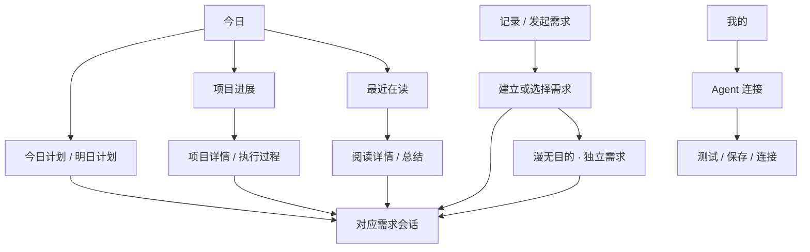
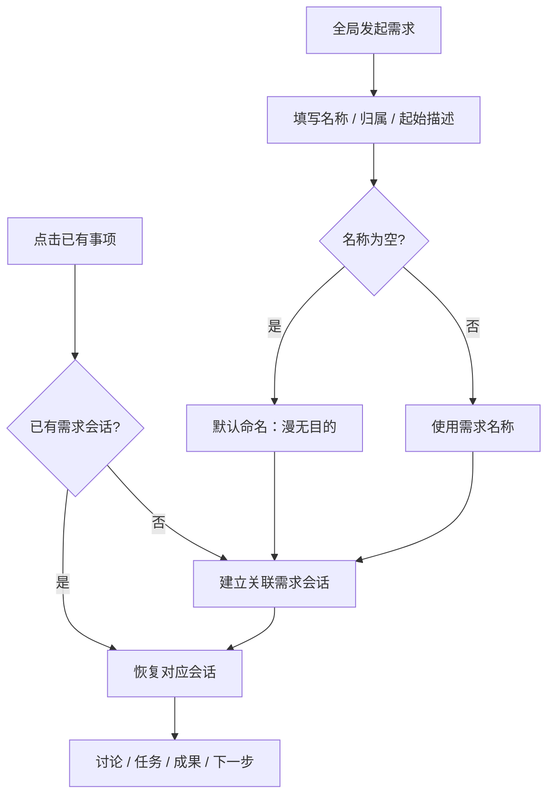
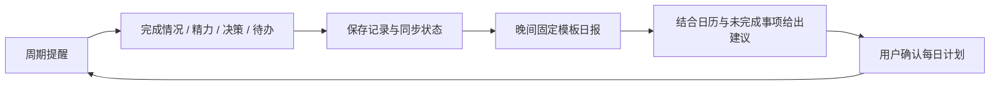
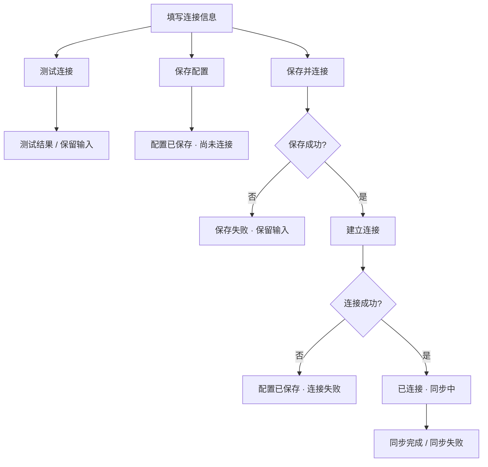

# HermesEye · 前端设计 V1.0

> 2026-10-06：新增 [V2.0 卡片化前端预研](14-frontend-design-V2.0.md) 与 [全页面可视稿](design/V2.0/index.html)。新稿为待确认设计，不覆盖本文件对应的 V1.0 当前规则，也不代表应用已经改造。

日期：2026-10-01。状态：用户已认可当前前端草图；本文沉淀已确认结构、交互规则与视觉约束。

需求依据：[痛点与产品需求 V1.0](08-product-requirements-V1.0.md)。视觉继承：[葱丁视觉规范 V0.2](07-visual-design-V0.2.md)。历史实现说明：[页面与交互设计 V0.2](history/V0.2/02-design.md)。

## 1. 文档效力与交付边界

- **已确认**：四入口、首页内容顺序、需求驱动会话、“漫无目的”独立需求、我的中的 Agent 连接与保存流程、当前草图和配色方向。
- **沿用约束**：葱青品牌、独立深浅主题、语义资源、真实状态、可访问性、凭据保护和上下文授权。
- **待细化**：细分页面中的完整字段、提醒机制、日报模板、同步冲突、运行控制与部署授权。本文相关建议均不能视为已完成的逐页高保真验收。
- 本轮保存文档和原型；没有修改 ArkUI 业务页面，也没有验证服务器、手机权限或真实数据联动。
- 草图中的时间、书籍、百分比、数量、项目进度和连接结果均为示例，不是用户实际数据。示例不构成固定配置或能力证明。

## 2. 可视设计资料

已将本次会话中的可点击草图导出到项目内，可用浏览器打开：

1. [首页、项目、阅读与基本流程草图](design/V1.0/home-and-navigation.html)。展示最初确认的信息结构；其中“阅读优先”属于早期比较选项，最终固定为今日计划优先。
2. [连接设置与需求会话修订稿](design/V1.0/connection-and-needs.html)。默认进入“我的”，包含 Agent 配置、连接结果演示及“漫无目的”会话建立流程；首页保持已确认顺序。

两份是设计演示，不是生产前端。连接、保存、发送等行为不访问实际服务；真实 Token 不应填入草图。修订稿和本文优先于早期草图。独立版本可能需要联网加载图标等展示资源；不以它验证鸿蒙原生体验。

### 2.1 首页空间示意

```text
┌──────────────────────────────────┐
│ HermesEye             Agent 状态 │
│ 今天，把事情往前推进             │
│ 日期                             │
│                                  │
│ 今日计划                查看全部 │
│ 会议 · 时间 / 来源                │
│ 今日事务 · 待完成 / 进行中        │
│ 下一次进展与精力记录             │
│                                  │
│ 项目进展                全部项目 │
│ 项目名 · 托管方式 · 进度         │
│ 当前状态 / 下一步 / 关联会话      │
│                                  │
│ 最近在读                阅读概览 │
│ 书名 · 阅读进度                   │
│ 笔记 / 划线 / 想法 / 周总结      │
│ 来源与更新时间 · 继续阅读会话     │
│                                  │
│       ＋ 记录 / 发起需求          │
├──────────────────────────────────┤
│    今日    项目    阅读    我的   │
└──────────────────────────────────┘
```

这是长页面的内容顺序，并非要求所有模块强行塞入单屏。手机首屏优先看见今日计划和主要操作，不通过缩小字体压缩内容。

## 3. 信息架构

| 一级入口 | 主要任务 | 二级页面 / 关联内容 |
|---|---|---|
| 今日 | 了解今天并继续推进 | 完整计划、计划制定、周期记录、精力日报、事项会话 |
| 项目 | 管理长期项目与独立需求 | 项目详情、需求会话、任务与成果、Agent 运行、部署状态、新建项目、独立需求 |
| 阅读 | 查看进度与疑问交互结果 | 自动笔记获取与定时整理、按书进度、疑问结果详情、必要设置 |
| 我的 | 配置入口与个人数据能力 | Agent 连接、数据来源与授权、知识空间、提醒与报告、显示模式 |

全局“记录 / 发起需求”可从主要页面触达；在连接配置、录入等表单页不重复展示，避免打断当前操作。连接状态可从页头进入“我的”；不能仅用绿色圆点表示已同步。



## 4. 页面规格

### 4.1 今日

对应 V1-H01～H04、V1-P、V1-E。

1. 页头：应用名、连接状态、日期；状态与同步时间可进一步查看。
2. 今日计划：会议时间与来源、重点事务及完成状态、进入完整计划的入口。
3. 周期记录提示：下一次记录时间及当前周期，进入记录表单。
4. 项目进展：项目名称、托管方式、任务或里程碑完成情况、阻塞 / 待确认状态、下一步、继续会话或查看执行过程。
5. 最近在读：书籍、进度、笔记 / 划线 / 想法 / 周总结数量、来源与更新时间、关联会话。
6. 全局记录入口与底部四项导航。

首页摘要数量与排序细节待真实数据验证。重要内容应易于扫读；不展示未经计算的效率分数，不将所有运行日志放入首页。任务完成数和里程碑完成数必须标明单位，不混为统一百分比。

空状态分别作用于对应模块：无计划时提示制定计划；无项目时提示建立项目；无阅读数据时提示连接或获取数据。单个模块失败不阻断整页；已缓存数据保留并显示更新时间。

### 4.2 今日计划与计划制定

- 计划页按当天展示完成、未完成和进行中的事务卡片；日历会议显示时间占用和来源。
- 事务卡片显示内容、状态与关联需求；可进入会话讨论该事项。
- 制定页面先展示可用的日历、未完成事项与近期记录，再展示 AI 建议和可编辑计划。
- AI 建议标“AI 生成”，可查看依据；用户确认后才写入正式计划，不能悄悄覆盖。
- 每晚强提醒直达计划制定页面；草图中的 22:00 仅为示例。
- 会议取消、日历更新、计划调整和跨天延后应保持可追溯；完整编辑规则待后续页面评审。
- 完成量说明统计范围与分母；不将会议已经过去自动视为工作已经完成。

### 4.3 周期记录与精力日报

录入内容：记录区间、关联项目 / 事项、完成与未完成内容、当前精力、决策、新增待办。字段是否必填需细化；快速记事不应因填写完整量表而被阻断。

区分“事件发生区间”和“保存时间”。补记标注补记，不把点击保存的时间当作工作开始时间，也不能从记录条数推导工时。

周期支持每小时、每两小时、半天等；强提醒、工作时段、稍后提醒和免打扰需要结合系统能力确认。强提醒不等于锁住设备或保证绕过系统限制。

日报入口展示日期、生成状态、模板结果与原始记录。建议模板方向为：完成事项、未完成事项、精力变化、重要决策、新增待办、次日建议；这是待确认的模板建议。缺失记录显式说明，精力变化基于自评而非医学判断。

### 4.4 项目、独立需求与新建项目

- 项目列表展示名称、托管方式、完成情况、当前状态和下一步。
- 托管方式为手工托管或 Agent 托管，对应独立 PARA Vault；具体写入权限另行确认。
- 新建项目提供名称、目标 / 完成标准、托管方式，再进入该项目下的需求会话。
- 项目详情应组织需求会话、任务、成果、知识和运行过程；不是把所有信息压进一条无限聊天流。
- 项目类型覆盖学习、鸿蒙开发、健身、工程开发、工资与开支、投资组合、摄影实践；不强迫不同项目使用同一进度指标。
- “独立需求”放在项目入口下，收纳暂不属于长期项目的需求，包括“漫无目的”。

“漫无目的”不是一个所有杂聊永久混在一起的全局会话。建立时可直接使用默认名称；不同会话保留独立标识与时间，避免同名内容混淆。后续可重命名或归入项目，保留对话关联。

### 4.5 阅读

2026-10-11范围收敛：只保留自动获取笔记、定时整理，页面展示阅读进度与疑问内容的交互结果。替代此前四项统计、周总结中心和IMA工作流要求，见 [19阅读规格](modules/19-reading-spec.md)。

- V1 实施采用普通书籍卡片：真实进度、来源时间、上次成功整理、各分批状态及用户问题的实际结果。
- 必要设置为书籍 ID 范围、周期小时数/时区、来源分享同意和启用/暂停；周期默认关闭。
- 选择来源笔记并确认 1–1500 字原文片段后提问；每个问题有独立持久会话，继续讨论与原操作查询分开。
- 未连接、来源未配置、无数据、缓存失败和 unknown 均显示真实状态；不推断用户已理解。
- 旧摘抄/总结保留为历史资料，退出四项统计与 IMA 文案。交互稿见 [阅读 V1](design/reading/index.html)。

### 4.6 需求会话

会话页的核心身份是“正在处理哪个需求”，标题优先呈现需求名称，并显示书籍 / 项目 / 独立需求归属。

- 从事项进入已有会话则恢复上下文；不存在时先建立关联会话。
- 从全局入口发起时填写可选名称和起始描述，名称为空默认“漫无目的”；可以选择归属。
- 单纯保存记录可以进入收件箱，不强制马上对话；“交给 Hermes”时必须关联需求。
- 同一项目允许多个会话；跨会话复用上下文需要可见的来源和范围。
- 会话重命名或移动不应复制出另一份独立历史，也不丢失成果关联。
- 回复标识 AI 生成；请求中的来源、快照时间和分享范围可查看。
- 生成建议、申请执行、实际运行、运行完成、部署完成分别呈现，不能用一条回复代替真实执行状态。
- 服务端恢复与本地缓存是 V1.0 需求；草图不能证明服务器重启后已经可恢复。

### 4.7 Agent 运行与成果

用于 Agent 托管工程及远端多 Agent 协作，展示任务目标、执行分工、状态、最近事件时间、过程、成果和部署情况。

候选状态：排队、执行中、待用户处理、失败、已完成。具体协议待联调。断线时显示最后收到的事件与恢复状态，不宣称任务停止，也不自动新建一轮任务。

成果区区分变更记录、检查结果、可访问成果与部署状态。是否自动部署、何时确认和怎样回滚仍待设计。停止等待只是客户端行为；只有收到服务端确认后才能说“任务已停止”。

### 4.8 我的

顺序建议：Agent 连接 → 数据来源与授权 → 知识空间 → 提醒与报告 → 显示模式。

- Agent 卡片显示名称、连接状态、配置或管理入口；配置和同步信息可进一步查看。
- 数据来源包括手机日历、华为运动健康、微信读书和 IMA；标明尚未授权、尚未获取、正常更新、更新失败等真实状态。
- 知识空间显示两个 Vault 的用途与托管关系，不暴露不必要的底层路径。
- 提醒与报告配置记录周期、计划提醒与日报；具体字段继续评审。
- 显示模式提供跟随系统 / 浅色 / 深色；持久化偏好是目标设计，不能把 V0.2 本次运行有效的切换当作完成。

### 4.9 Agent 连接

| 字段 / 操作 | 设计约束 |
|---|---|
| 连接名称 | 便于辨认，例如“家庭 Hermes” |
| IP / 域名 | 支持填写服务器地址；输入提示不限定必须在公网 |
| 协议 | 默认 HTTPS；HTTP 仅在明确允许的受信任私有网络场景使用 |
| 端口 | 单独填写并校验有效范围；示例 443 不是所有部署的固定端口 |
| Token | 默认遮蔽，提供显示 / 隐藏；正式应用目标为本机安全保存 |
| 下次打开时连接 | 用户可选择使用保存配置连接当前 Agent |
| 测试连接 | 检查当前配置，不因为测试成功就声称保存或同步完成 |
| 保存配置 | 保存地址与凭据，不要求必须联网成功；保存结果与连接结果分开 |
| 保存并连接 | 保存成功后建立连接，再进入业务同步；分阶段反馈 |

Token 不进入普通持久化、日志、备份、业务同步或原型状态。若安全存储失败，应提示保存失败，不能退化为明文保存后显示成功。正式实现需核验安全存储能力；当前工程的进程内 Token 方案不满足 V1.0 的免重填目标。

连接失败保留输入，错误可区分地址 / 网络不可达、认证失败和其他服务错误。保存配置、认证、建立连接和数据同步必须分别判断。自动连接只恢复连接与读取状态，不得因此重放执行、部署等有副作用的请求。

## 5. 核心交互流程

### 5.1 从需求进入会话



### 5.2 记录到计划的反馈



### 5.3 连接与同步



## 6. 状态、异常与数据真实性

| 场景 | 应展示的状态与恢复方式 |
|---|---|
| 初次未连接 | 说明可配置 Agent；已有本地内容可浏览，不假装在线 |
| 加载 / 同步 | 保留已有内容，局部显示进度，标识最后同步时间 |
| 本地保存成功 | “已保存到本机”；未收到远端确认不得显示“已同步” |
| 保存失败 | 保留输入，说明原因并可重试；不先清空表单 |
| 远端不可达 | 显示断线 / 数据可能过期，保留本地副本 |
| Token 无效 | 提示更新凭据，不在日志或错误信息回显 Token |
| 业务请求超时 | 先查询原任务状态，再决定重试，不默认重新执行 |
| 权限拒绝 / 撤销 | 标明受影响来源，提供授权入口；其他模块继续工作 |
| 数据缺失 | 显示尚未获取或暂无数据，不用 0 伪装有效统计 |
| AI 建议 | 标识生成内容与引用来源；不声称行动已发生 |
| 客户端停止等待 | 不宣称服务端任务已经停止 |
| 服务端重启 / 多端接入 | 恢复服务器保存的需求、会话和状态，显示同步结果 |
| 多端冲突 | 不静默覆盖；具体合并与用户处理流程待技术设计 |

草稿在页面切换和失败时应保留；详情返回应保留列表位置。切换连接时的数据隔离和未发送草稿处理仍需明确设计。连接表单等敏感输入不通过可视原型的宿主状态持久化。

## 7. 配色约束

配色继承已认可的葱青 / 米白方案。正式 ArkUI 组件引用语义色资源，不在页面分散硬编码。以下资源名与当前工程一致：

- 浅色：[base/element/color.json](../entry/src/main/resources/base/element/color.json)
- 深色：[dark/element/color.json](../entry/src/main/resources/dark/element/color.json)

| 资源名 | 浅色 | 深色 | 用途 |
|---|---|---|---|
| `bg_page` | #F5F2EA | #141A17 | 页面底色 |
| `bg_surface` | #FFFFFF | #1D2521 | 内容卡片 / 列表 |
| `bg_elevated` | #FFFFFF | #26322B | 弹层 |
| `text_primary` | #202326 | #EEF3EF | 标题、正文与数值 |
| `text_secondary` | #637168 | #AAB8AF | 来源、时间、辅助信息 |
| `action_primary` | #34785A | #80C7A3 | 主操作与选中图标 |
| `action_pressed` | #285E46 | #A0D6B9 | 按下状态 |
| `action_on_primary` | #FFFFFF | #13241B | 主操作上的文字 |
| `selection_bg` | #E8F0EB | #263D30 | 选中底色 |
| `selection_text` | #285E46 | #A0D6B9 | 选中项文字 |
| `border_subtle` | #DCE4DE | #3D4D43 | 装饰分隔线 |
| `border_control` | #75857A | #82998B | 可识别的控件边界 |
| `focus` | #34785A | #80C7A3 | 焦点环 |
| `disabled_bg` | #E4E7E2 | #303A33 | 禁用背景 |
| `disabled_text` | #758079 | #87938B | 禁用文字 |
| `status_success` | #34785A | #80C7A3 | 成功文字 / 图标 |
| `status_success_bg` | #E8F0EB | #263D30 | 成功容器 |
| `status_warning` | #96501C | #F1B77E | 待处理 / 注意 |
| `status_warning_bg` | #FFF0E2 | #392B20 | 注意容器 |
| `status_error` | #A73535 | #F0A5A5 | 错误与失败 |
| `status_error_bg` | #FDECEC | #3B2428 | 错误容器 |
| `status_info` | #4B6E8A | #A7C8E2 | 中性信息 |
| `status_info_bg` | #EDF3F7 | #23313D | 中性信息容器 |

`start_window_background` 与对应主题的 `bg_page` 保持一致。

使用规则：

1. 葱青作为主要操作和识别色，不用大面积绿色铺满页面；主体依靠留白、底色和文字层级。
2. 深色模式独立配色，不整页反色；图片和来源内容保留原色。
3. 同一主要操作区域保留一个突出动作；“测试连接 / 保存配置”为次操作，“保存并连接”为主操作。
4. 暖橙 #E98B42 仅可作少量装饰提示；不作浅底小字或白字按钮。待处理文字使用 `status_warning`。
5. 红色用于错误、失败或破坏性操作，不用大面积红色惩罚未完成任务；待确认用文字与适当警示底色。
6. 不能只靠颜色传递状态：同时使用“待处理 / 已完成 / 失败”等文字，以及图标或形状。
7. 正文及必要辅助文字目标对比度至少 4.5:1，必要控件边界与状态图形至少 3:1；装饰分隔线不承担唯一识别责任。
8. 典型纯色组合沿用 V0.2：白字 / 葱青约 5.28:1，次级文字 / 米白约 4.59:1，深色按钮文字 / 夜间主色约 8.19:1；实际透明度、焦点和叠层仍须逐页验证。
9. 图表主系列优先葱青，第二系列可用信息蓝；同一数据类型映射一致，辅以标签和线型；不制造装饰性效率仪表盘。

## 8. 字体、布局与组件约束

| 项目 | 约束 |
|---|---|
| 字体 | 系统字体，跟随系统字号；代码等必要场景才用等宽字体 |
| 标题 | 页面 24fp，分区 18fp |
| 正文 / 按钮 | 16fp；辅助说明 14fp；非核心短标签可 12fp |
| 行高 | 正文约 1.5 倍，标题约 1.25 倍；原生实现结合字体测试 |
| 间距 | 4 / 8 / 12 / 16 / 24 / 32 / 48vp |
| 手机边距 | 16vp，较宽窗口可 24vp |
| 卡片 | 内边距 16vp，卡片间 12vp，分区间 24vp |
| 圆角 | 标签 8vp，按钮 / 输入 12vp，卡片 16vp，弹层 24vp |
| 操作尺寸 | 触控区至少 48×48vp；可随内容和字号增高 |
| 图标 | 统一线性图标体系，24vp 基准，配文字；不混用表情作为导航图标 |
| 分层 | 留白、底色和细线优先；浮层才使用轻阴影 |
| 动效 | 按压约 120–160ms，展开约 180–240ms，转场约 240ms；尊重减少动态效果设置 |

草图的 HTML 像素尺寸只用于交互评审，落地以原生 vp / fp 和真实设备表现为准。禁止连续卡片套卡片、霓虹、整页渐变、装饰性 3D 和科幻 HUD。长标题可换行，重要正文提供完整查看，不以固定高度裁掉内容。

按钮执行中防重复提交；空状态给一个明确动作；输入失败保留文字；错误说明靠近相关操作；原型出现的“示例 / 演示”不是正式产品常态文案。

## 9. 适配与可访问性

- 默认手机单列，底部四项导航；大字号时容器增高、必要时改单列。
- 600vp 与 840vp 可沿用为初始适配参考；平板侧栏及列表 / 详情双栏属于待验证的细化方案。
- 宽屏不无限拉长文字，内容阅读区建议约 720vp；保持当前需求与草稿。
- 处理安全区域、键盘遮挡、横屏和分屏；输入区始终可到达。
- 控件有可读名称，焦点可见，状态变化可被辅助技术理解。
- 页面切换、主题切换不丢失未提交内容；主题和显示偏好的持久化需实现验证。

## 10. 设计与实现验收

当前确认的是设计方向，不勾选下列实现验收项。

- [ ] 首页顺序与四项导航正确，关联会话跳转不串需求。
- [ ] “漫无目的”可建立、找回、重命名和归入项目，并保留历史。
- [ ] 记录、周期记录、日报、计划建议与确认形成可追溯流程。
- [ ] 阅读进度与疑问交互结果真实，未知/失败状态明确。
- [ ] 项目托管方式、运行事件、成果与部署状态可区分。
- [ ] Agent 配置可安全保存，重启后复用；保存 / 连接 / 同步状态准确。
- [ ] 无效 Token、服务器不可达、存储失败时输入保留且错误可恢复。
- [ ] 服务器重启、多端连接与本地副本恢复经过真实验证。
- [ ] 日历、健康、微信读书和 IMA 数据链路经过联调，权限可撤销。
- [ ] 强提醒在目标设备、熄屏与后台场景中验证，不虚报能力。
- [ ] 各主要页面覆盖浅色、深色、空、加载、失败、长中文和大字号。
- [ ] 320vp、键盘弹出、横屏 / 分屏及读屏可完成核心流程。
- [ ] 颜色来自语义资源，实际页面对比度与状态表达通过检查。

后续先按模块细化页面和异常状态，逐轮取得用户确认，再进入应用改造。验收证据最终记录到 [发布与验收记录](05-release.md)，不以原型可点击或编译通过代替真机、网络与 Agent 执行验证。

## 11. 每日计划细化 · 2026-10-03

本轮用户授权按模块设计并开发，新增 [每日计划规格与前端交互设计](modules/11-daily-plan-spec.md) 和 [交互设计稿](design/daily-plan/index.html)，落实按日列表、独立编辑、重要性/用时、明确状态、筛选、改期/移除、日历与历史建议。原有四入口与配色保持；新增规则作为本轮实施方案记录，逐页视觉验收尚未完成。实现和未接入边界见 [开发记录](modules/12-daily-plan-implementation.md)。

### 2026-10-06 · 系统反馈异常边界（问题8）

页面结构与交互稿不变。Toast 系统调用失败时保留业务操作结果，仅记录脱敏诊断且不写入提示去重状态；系统恢复后允许再次显示同一反馈。主题切换失败沿用页面已有恢复提示，不静默宣称系统主题已切换。平台调用由服务层承接，构建/设备证据见 [05](05-release.md)。

### 2026-10-07 · 独立业务预览入口

“我的”新增独立业务服务入口，作为 A2 本地验证界面。先显示根地址、当次 Token 和私网 HTTP 显式开关；有既存副本时先离线读取。连接校验稳定身份后提供手动同步、保留 outbox 的快照重建、今日计划新增/删除、冲突双方选择、会话发送及原操作查询。操作中禁用表单；错误保留副本与待确认意图。会话发送不复制旧历史，未知结果不呈现成功。对应草图见 [业务预览](design/business-preview.html)。现有四页尚未整体切换到新服务。

## 2026-10-09 · 项目模块前端细化

项目列表增加名称/目标搜索与状态筛选，默认进行中。新建/编辑分开填写目标和完成标准；详情以概览、里程碑、复盘组织内容，下方保留需求会话与关联任务。达成须填依据并确认，归档保留关联数据；任务计数不等于目标达成。Hermes入口准备可编辑的新需求摘要，继续既有会话仍走原需求入口。软件项目显示远程能力尚未接入。规格与布局详见[17](modules/17-project-spec.md)，交互示例见[项目原型](design/projects/index.html)，实际边界见[18](modules/18-project-implementation.md)。

## 2026-10-11 · 项目 V1 业务入口

项目详情提供“项目持久会话与显式同步”，连接独立业务服务后，确认目标、标准、里程碑和复盘加入 outbox，再显式同步；冲突由用户选择，远端快照不自动覆盖本机项目。发送前可以编辑项目摘要（含最近三条复盘），项目有稳定 Need，回复/未知状态和原操作查询来自业务账本。旧关联需求会话保留兼容流程，不伪装已迁移；托管偏好不授予执行或部署权限。


## 2026-10-11 · 实施版本说明

V1 业务范围与数据约束继续有效；用户本轮授权 `dev` 实施 [V2 前端](14-frontend-design-V2.0.md)。当前卡片、弹层、悬浮导航与会话布局以14为准，实际完成程度见 [21](21-frontend-v2-implementation.md)，不再沿用旧记录中“暂不实现V2”的本轮限制。
