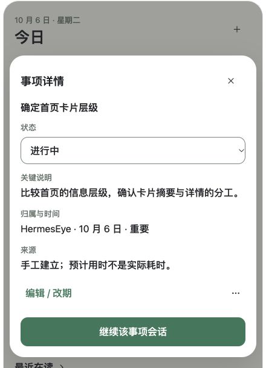
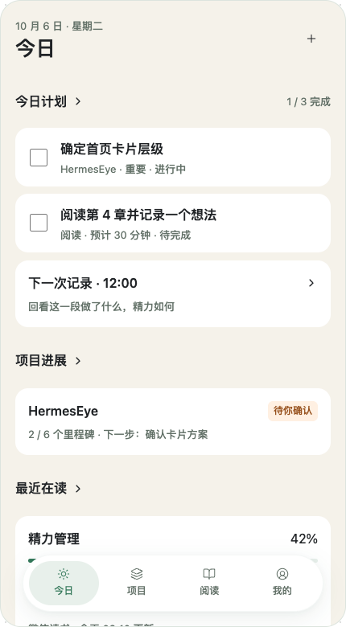

# HermesEye · 前端设计 V2.0（卡片化预研）

日期：2026-10-06。状态：**全页面设计评审稿；取消勾选与详情入口层级已于 2026-10-06 确认，悬浮胶囊导航已于 2026-10-09 确认，其余细节待评审；未进入生产代码开发。**

需求基础：[08 产品范围](08-product-requirements-V1.0.md)、[09 V1.0 前端设计](09-frontend-design-V1.0.md)、[每日计划当前规则](modules/11-daily-plan-spec.md)。本稿继承全部业务范围，不把尚未接入的 V1.0 能力延期成 V2.0 新需求。V2.0 在本轮指前端展示与操作方式的提前设计。

可视评审：[全页面卡片交互稿](design/V2.0/index.html)。页面巡览选择器属于评审工具，不进入正式产品；数据、连接、执行、保存和统计均为示例。稿件覆盖 24 个页面场景及对应详情 / 编辑卡片，支持勾选完成、撤销、点击详情、需求跳转和主题预览。具体业务校验与远端调用未实现。

事项详情的浏览器预览截图（设计样例，不是鸿蒙设备截图）：



## 1. 用户要求、沿用约束与待确认提案

### 用户本轮明确要求

- 全应用采用卡片式设计，尽量减少页面按钮。
- 主页面只保留关键文字、关键内容和关键控件。
- 每日计划每项有独立 box 控件，完成后直接点击完成。
- 事项完整内容由 dialog 等卡片承载。
- 先完成设计，不写应用代码，作为 V2.0 提前设计。

### 沿用的已确认内容

- 主导航：今日 / 项目 / 阅读 / 我的；首页顺序：今日计划 → 项目进展 → 最近在读。
- 所有会话从需求出发；“漫无目的”也是独立需求，不引入全局无归属聊天。
- 我的中保留 Agent 地址、Token、安全保存与再次连接。
- 全部阅读、日历、健康、周期记录、日报、双 Vault、跨会话上下文、多 Agent、部署与同步范围继续保留。
- 葱青、米白及独立深色语义色继续沿用。

### 本轮已确认 · 2026-10-06

- 取消已完成事项的勾选后，状态回到“待完成”（todo）。
- 接受“卡片正文 → 对象详情 → 关联需求会话”的入口层级；首页事项、项目和书籍按此规则进入会话。
- 本次确认只确定上述设计规则，不代表全稿通过或授权应用代码实施。

### 其余建议，等待评审

box 解释为独立方形完成复选框；点正文打开详情、点复选框直接改变完成状态。简单对象用底部详情卡，长篇内容用独立页面；每个主要操作区最多一个高强调按钮。撤销、详情字段就地保存、表单草稿等其余具体规则仍属于本稿提案，不能据此声称用户已逐项批准。

## 2. 重新梳理交互逻辑

### 2.1 信息分为四层

| 层 | 用户此刻的问题 | 内容 | 主要交互 |
|---|---|---|---|
| 概览卡 | 这是什么？现在怎样？ | 标题、关键值、关键状态、必要时间 / 来源 | 点击卡片正文进入详情 |
| 直接操作 | 我现在能推进什么？ | 完成框、必要选择控件 | 一次完成，不先打开编辑表单 |
| 详情卡 | 具体内容和依据是什么？ | 完整说明、来源、归属、状态、关联信息 | 一个主要动作；其余进入字段或更多菜单 |
| 工作页面 | 我要持续阅读 / 输入 / 跟踪 | 长会话、长报告、项目工作区、运行过程 | 独立页面，不挤在小弹窗内 |

减少的是重复动作和同时暴露的控件，不删除能力、不把关键操作仅藏在长按或滑动中。整张卡片可点击时，在视觉上使用一致的容器与必要箭头；读屏名称包含对象和操作含义。

### 2.2 按钮与点击区域约束

1. 普通摘要卡不放“查看详情”按钮，卡片正文就是详情入口。
2. 可完成事项仅外露一个完成复选框；完整说明、来源依据、改期、删除、会话移至详情。
3. 状态、重要性、来源标签默认只读；需要可操作时放在详情明确的字段中，避免看起来可点却没有作用。
4. 一个页面主要内容区最多一个高强调主动作；导航、筛选、复选框、返回与关闭不计为主动作，但仍纳入密度检查。
5. 列表页采用一个新增入口；不同时放顶部加号、底部大按钮和每段新增。今日顶部“＋”打开新建动作卡；每日计划二级页保留底部“添加事项”。
6. 高频、可逆操作不弹确认；破坏性或外部执行仍需足够的确认信息，不为少一个按钮而取消授权。
7. 提醒开关、模式选择即时保存时不另设重复“保存”；多字段表单保留一个明确提交动作。
8. 详情中的“更多”用于改期、移除、归档等次操作；主要功能不能全塞进省略号。无需靠手势才能发现功能。

### 2.3 卡片不是把现有页面加一圈边框

每个卡片代表一个真实对象或一个同目的设置组。最多两层内容容器；段落不逐句装卡。主页面不显示调试路径、HTTP 状态码或长权限解释，错误详情中可查看必要诊断。错误、待确认、离线与陈旧数据不能因精简而隐藏。

## 3. 全局信息架构与容器选择

| 页面组 | 持续保留的页面 | 通过详情 / 编辑卡呈现 |
|---|---|---|
| 今日 | 首页、每日计划、制定次日计划、记录列表、日报 | 事项详情 / 编辑、日期选择、会议详情、日历选择、历史建议、单条建议、周期记录 |
| 项目 | 项目列表、项目详情、独立需求列表、需求会话、运行过程、成果列表、认知积累 | 新建项目 / 需求、里程碑、行动确认、执行事件、成果详情、部署确认、认知条目 |
| 阅读 | 按书进度、疑问交互结果与详情 | 来源片段、必要整理设置与失败恢复 |
| 我的 | 我的、Agent 连接、数据来源、知识空间、提醒与报告、主题、同步 | 地址 / Token / 高级配置、诊断、授权详情、Vault 详情、单项提醒、同步差异 |

底部导航只在主浏览页面保持稳定；进入会话输入、长表单及键盘状态时减少其他导航干扰。原型保留导航以便巡览，正式适配以此规则为准。

### 悬浮胶囊底部导航 · 2026-10-09

用户明确要求：保留“今日 / 项目 / 阅读 / 我的”的内容、顺序与跳转，仅调整外观；水平居中，固定在屏幕底部并留出间距，大圆角、平滑边缘与柔和弥散阴影，色调统一，不用粗阴影或夸张装饰。

用户于 2026-10-09 确认当前预览符合预期。以下尺寸、圆角、悬浮间距和阴影作为已确认的 V2.0 设计基线；该确认不代表应用代码实施授权或设备适配验收：

| 项目 | 设计约束 |
|---|---|
| 定位 | 固定于应用可视区域底部，随内容滚动保持位置；不是列表末尾的一张卡片 |
| 宽度 | 屏宽减40vp，最大374vp，水平居中；四个入口等宽 |
| 底部间距 | 系统底部安全区以上18vp；与手势区域分离 |
| 外形 | 胶囊圆角999vp；内边距7vp，入口高度至少54vp，总高约70vp |
| 颜色 | 浅色白色胶囊配米白页面，深色沿用surface语义色；选中态用soft背景与brand图文 |
| 阴影 | 浅色0/8/28、深绿8%透明度，辅以0/2/6、3%透明度；深色黑色19%与9%；均无扩张值 |
| 边缘 | 1vp极淡轮廓，取消旧式通栏顶部分割线；不加高光、渐变或额外装饰 |
| 选中态 | 小胶囊底色＋图标和文字强调；保留可访问选中状态，文字始终可见 |
| 内容避让 | 滚动区底部预留至少114vp＋安全区，最后一项可完整滚动至导航上方；反馈提示位于胶囊上方 |
| 层级与适配 | 详情遮罩在导航上方且隔离底层操作；键盘、长表单与会话页面沿用既有隐藏规则。大字号可增加高度并同步调整内容留白，不能裁切文字 |

原型以固定高度手机容器模拟屏幕，内容区独立滚动；这些尺寸是设计基线，不是已验证的鸿蒙设备参数。四入口功能和已确认的“正文 → 详情 → 关联会话”逻辑不变。




### 3.1 弹层统一规范

- 手机短详情优先底部 sheet；宽屏使用居中 dialog 或侧边详情。原型采用居中的卡片式弹层来评审内容分工，不作为系统转场规格。
- 同时只呈现一个活动弹层。详情 → 编辑 → 更多 / 确认使用同一容器切换内容，提供清晰返回；不叠三层遮罩。
- 查看态：标题、关闭、完整正文、来源、一个主要动作；关闭后恢复触发卡片与滚动位置。
- 编辑态：标题、字段、一个提交动作；未保存关闭需保留草稿或放弃选择，绝不能默默丢失。
- 长说明 / 多字段表单超过可用高度时扩展为大尺寸 sheet 或独立编辑页，支持滚动和键盘避让；不硬裁剪。
- 触摸背景只可关闭无修改的查看态；编辑态不通过误点遮罩丢失输入。系统返回与关闭按钮遵循相同规则。
- 模态期间背景不可操作、焦点限制在弹层；关闭回到原触发点。需读屏名称与错误播报。

## 4. 每日计划：本轮最重要的交互重构

### 4.1 列表中每项只留什么

```text
┌─────────────────────────────────┐
│ □  确定首页卡片层级              │
│    HermesEye · 重要 · 进行中     │
└─────────────────────────────────┘
  ↑独立完成区    ↑正文详情区
```

- 标题，必要项目 / 时间，重要标识，以及 todo / doing / done 的文字状态。
- 预计用时可作为次行信息；不等于真实耗时。
- 说明、来源依据和所有按钮不再铺满列表。长标题最多两行后可以省略，但完整文字在可访问名称和详情中可查看；核心标题不能仅依赖悬停读取。
- 完成框视觉 22–24vp，独立触控区域至少 48×48vp。卡片正文与完成框是并列点击区域，不能把复选框嵌套在整卡按钮里。
- 日历会议使用时间 / 日历图标卡，默认不显示事务完成框；如需要记录本机会议状态，从详情选择，仍不参与事务完成统计。

### 4.2 完成、进行中与恢复

| 操作 | 提案规则 | 失败 / 可逆性 |
|---|---|---|
| 未完成 / 进行中点击方框 | 设置 done；不打开详情 | 本机保存成功后确认；失败保留原状态并就地报错 |
| 点击已完成方框 | 重新打开为 todo | “重新打开为待完成”反馈；可撤销 |
| 点击正文 | 查看详情 | 不改变完成状态 |
| 详情中选择进行中 | 明确选择 doing，不循环切换状态 | 保存成功后更新详情与列表 |
| 撤销刚才的状态变化 | 恢复变更前的状态，包括 doing | 基于同一对象；其他更新或冲突时不能盲目覆盖 |
| 已完成展示 | 打勾 + 状态文字 + 适度划线 | 不以极低透明度使内容不可读 |

建议完成后短暂保留原位，不立即跳动重排；未完成筛选下待轻量反馈后移出，完成项从筛选可找回。原型即时更新用于演示，不代表最终动效时长。

详情状态区保留完整三态；复选框不承担三态循环，也不把“进行中”误显示为“已完成”。“取消勾选恢复 todo”已于 2026-10-06 获用户确认，作为 V2.0 设计规则；本轮不修改 V1.0 实现。

### 4.3 每日计划页面布局

页头“每日计划”与工具菜单 → 可点击的当前日期 → 完成摘要 → 状态筛选 → 事项卡 → 日历占用卡 → 添加事项。

工具菜单收纳日历选择、历史建议、进展记录 / 日报、晚间提醒。首页保留三模块顺序，不把全部计划工具铺进首页。

筛选提案默认“全部 / 未完成 / 已完成”，进行中包含在未完成；需要精确查看时从筛选面板提供 todo / doing / done。不能移除现有按三态查询的能力。原型显示的是简化首层筛选。

日期点击打开日期选择，提供前后日期及回到今天；新增取所选日期。当天无事项时仅保留一个“添加事项”主动作，日历和建议仍能从工具菜单进入。

### 4.4 详情和编辑

详情呈现标题、三态选择、日期、项目、重要性、预计用时、完整说明、来源和采纳依据。主动作“继续该事项会话”；编辑 / 改期为次动作，移除进入更多菜单后确认。

编辑表单首层只放标题、日期和说明；项目、重要性、预计用时按组折叠，但已有非默认值在折叠摘要中可见。保存校验继承现行 1～200 字标题、最多 4000 字说明、1～1440 整数分钟等规则。无效输入保留并在相应字段显示错误。

日历项禁止直接改日期；手工改期保留 ID、状态和会话。移除仍保留会话，且不会删除系统日历或自动取消独立注册的提醒。改名不自动改写既有会话历史。

### 4.5 日历与建议单独承载

- 日历列表进入单独 sheet / 页面；首屏显示日期、读取状态，获取成功后显示候选项。初次未读取仅提供“读取日历”；已读取时刷新放工具区。
- 候选项用复选框选择，“加入所选事项”是唯一主提交动作；同实例已导入项显示已加入且不可重复选。
- 相同标题来自不同日历 / 事件时展示来源日历和必要标识，不按标题静默合并；这是针对既有重复观感的展示提案，不宣称问题7已定位或修复。
- 日历实例去重、当地自然日、原子导入、权限与分享分离继续沿用。
- 历史建议为摘要卡，点开才显示完整来源和单条采纳按钮；仍然逐条即时保存，不引入未经确认的批量采纳。
- 采纳不移动原计划、不自动完成来源；同源同日去重、来源过期校验、超长待办拆分规则继续沿用。

## 5. 今日、记录与日报

### 今日

首屏问题是“今天要推进什么”。页头日期、一个新增入口；今日计划模块展示少量事项，支持直接勾选。点击模块标题进入完整列表。项目卡展示完成单位和下一步；阅读卡展示进度与来源。

周期记录提示是一张可点击的提醒卡，不再同时放“记一笔 / 查看记录 / 写日报”等成排按钮。项目或书籍点击后先进入对象详情，从详情进入对应会话；这是相较 V1.0 直达会话的层级调整，已于 2026-10-06 获用户确认。

### 记录

列表卡只显示事件区间、内容摘要、必要的精力自述与补记标识。点卡查看完整完成情况、未完成、决策和待办；新增记录 sheet 首层只需正文，更多字段渐进展开。非目标用户确认的精力评分不擅自引入。

“新增待办”从记录详情进入计划编辑，经确认后加入，不能直接把生成文本当作已创建任务。草稿按空间隔离，跨服务器不带出。

### 日报

长阅读页面，正文是主要内容，不把每句总结套卡。只保留日期 / 来源 / AI 标识、结果正文、来源入口和一个“安排明天”动作。生成、知识写入和通知送达状态分别呈现。无记录时说明覆盖不足，不生成精确效率评分。

## 6. 项目、需求、Agent 与第二大脑

| 页面 / 卡片 | 列表保留 | 详情与主要动作 |
|---|---|---|
| 项目列表 | 名称、托管方式、真实进度、待处理状态 / 下一步 | 点击进入项目工作区；新增从页头统一入口 |
| 项目详情 | 目标摘要、当前需求、任务 / 成果 / 认知入口 | “发起项目需求”；各对象点击进入对应内容 |
| 独立需求 | 名称、日期、必要状态 | 点卡继续已有会话；新建留空命名“漫无目的” |
| 新建项目 | 名称、目标、托管方式 | 一次确认创建，不把后台能力配置塞进首屏 |
| 需求会话 | 需求身份、消息、必要上下文入口 | 发送是主控件；长回复连续阅读；建议才使用动作卡 |
| 上下文选择 | 来源名、范围、快照时间、选择状态 | 本次确认；默认不分享额外数据，不把选择视为永久授权 |
| Agent 运行 | 任务目标、当前步骤、最近事件时间 | 点步骤看事件；停止等操作进入明确控制卡，必须有真实回执 |
| 成果与部署 | 成果标题、检查结果、部署状态 | 部署确认卡展示目标 / 影响 / 权限 / 恢复信息，不能仅点卡自动部署 |
| 认知积累 | 问题、当前理解、证据数量、待验证状态 | 点开看证据、理解变化与待实践问题；不使用虚构认知完成率 |

会话退出返回来源对象和原位置；不能统一退回项目首页。确认执行的卡片在受理后显示运行状态，不反复出现“执行”按钮。网络超时需查询原执行状态，禁止自动重放有副作用请求。

健身、财务、摄影等项目使用同一对象卡片规则，不强迫相同 KPI：健身显示已记录训练与授权数据；财务摘要标金额、单位、期间和来源，暂无数据不填 0；摄影展示练习主题、作品与复盘。首版设计稿以项目详情示例承载，不凭未知数据增加自动交易、健康评分或专用复杂仪表盘。

## 7. 阅读与自动整理

2026-10-11用户最新确认：只保留自动获取笔记、定时整理，页面展示阅读进度和疑问内容的交互结果。替代本节此前书籍统计/周总结/IMA布局，详见 [19阅读规格与文字线框](modules/19-reading-spec.md)。

- 阅读页建议按书组织进度及疑问交互摘要；点击查看来源与完整回答。
- 长回答连续阅读，保留继续讨论入口；不将回答自动标为“已理解”。
- 必要自动整理设置保留来源范围、周期/时区、启用与暂停，不设IMA目标。
- 不再要求四项计数面板、独立周总结中心和复杂工作流页。
- 疑问的产生方式与具体页面细节待确认。全页面HTML原型的阅读相关场景为旧版演示，暂不作为当前阅读验收依据；本轮只更新文档线框，未修改原型代码。

## 8. 我的、连接与个人数据

### 我的

第一张卡为当前 Agent，显示连接名与真实连接状态；下方按组放数据来源、知识空间、提醒与报告、同步与显示模式。每行可点击，无重复“管理 / 进入 / 查看”按钮。

### Agent 连接

配置页由地址、凭据、高级选项三张可点击字段组组成；点击进入编辑卡。首层显示非敏感摘要，不显示 Token 内容。

- 地址包括 IP / 域名、协议和端口，HTTPS 默认；HTTP 必须显式允许受信任私有网络。
- 凭据卡显示已保存 / 未设置 / 无效；替换时在本机输入，Token 只进 Asset Store，不跟随普通草稿、日志、备份或业务同步。
- 高级字段保留连接名称、路径、模型；不能为了视觉简化删除已有连接能力。
- 表单的主动作是“保存并连接”。“仅保存配置”保留为低强调文字行；“连接诊断”卡内提供测试，测试不自动保存。
- 子卡“保留修改”只更新当前配置草稿；最终保存才持久化。退出整页仍需处理未保存配置。
- 下次自动连接开关不等于自动重试执行任务。存储、认证、连接、同步分别反馈；失败时保留可安全保留的输入。

### 数据来源与知识空间

每个来源一张状态卡：未授权、尚未获取、更新时间、失败。点开查看范围与授权，不在首页放授权长说明。读取、同步、向模型分享分别控制。

两个 Vault 各有用途、PARA 结构和权限说明卡；托管方式不等于无限执行权限。Obsidian 插件同步与业务同步不同，不合并为一个“已同步”状态。

### 提醒、主题与同步

提醒配置一类型一卡：周期记录、晚间计划、日报；详情内配置时间、周期和必要启停。强提醒效果仍需能力和设备验证。

主题页面使用单选项并即时预览 / 保存，无额外主按钮。失败保持原有效主题并提示。

同步页以对象类别与待处理差异卡组织。冲突点开看本机 / 远端差异，选择策略需在真实契约确认后启用；不提供“全部覆盖”捷径。未接入时显示能力状态，而非演示时间。

## 9. 全局状态与操作恢复

| 状态 | 卡片与弹层行为 |
|---|---|
| 正常 | 摘要足够判断，点开完整内容 |
| 加载 | 保留已有内容，局部进度；敏感提交禁用防重复 |
| 空 | 一句说明 + 一个建立内容的主动作 |
| 离线 | 本机内容可读，标明来源和最后更新时间，远端操作不可伪成功 |
| 保存失败 | 复选框保持原值；编辑留在原表单；错误就地可见，不仅 Toast |
| 认证失败 | 连接卡标识失败，凭据页可恢复；不泄露 Token |
| 权限拒绝 | 受影响数据源显示恢复路径，其他手工功能可用 |
| 冲突 | 保留两份与差异，不静默覆盖 |
| 已完成 | 形状 + 文字表达，保留查看与重新打开 |
| 无法恢复执行结果 | 明示状态未知，先查原任务，不自动新建执行 |
| 已有输入关闭 | 保留草稿 / 放弃；返回原对象不丢位置 |

## 10. 视觉规范

### 颜色

沿用 V1.0 完整语义色资源，避免在 V2.0 引入另一套近似绿色。关键组合：

| 用途 | 浅色 | 深色 |
|---|---|---|
| 页面 | #F5F2EA | #141A17 |
| 卡片 | #FFFFFF | #1D2521 |
| 弹层 | #FFFFFF | #26322B |
| 主文字 | #202326 | #EEF3EF |
| 次文字 | #637168 | #AAB8AF |
| 主操作 / 勾选 | #34785A | #80C7A3 |
| 主操作文字 | #FFFFFF | #13241B |
| 选中背景 | #E8F0EB | #263D30 |
| 必要控件边界 | #75857A | #82998B |
| 警示文字 / 底色 | #96501C / #FFF0E2 | #F1B77E / #392B20 |
| 错误文字 / 底色 | #A73535 / #FDECEC | #F0A5A5 / #3B2428 |

普通卡片以表面与留白区分，少用阴影和描边；必要复选框 / 输入轮廓仍需清晰。色彩只强调主动作、选中和真实状态；不为每个项目随机分色。阴影只用于浮层；遮罩用于聚焦背景，不作为长期页面装饰。

### 尺寸与可访问性

- 正式原生尺寸继承 24fp 页面标题、18fp 分区、16fp 正文 / 按钮、14fp 辅助信息。
- 卡片圆角 16vp、内边距 16vp、间隔 12vp、分区间隔 24vp；弹层圆角 24vp。
- 触控区域至少 48vp，视觉小图标仍提供足够命中范围。主文字与必要说明目标 4.5:1，控件 / 状态图形目标 3:1。
- 已完成卡不整体降到不可读；状态不只靠颜色。图标统一线性体系，有读屏名称。
- 320vp、大字号、键盘、横屏、分屏必须保持完整内容与提交动作可达。
- 宽屏将详情放侧边栏，复用字段与状态规则；移动端选择的对象和草稿不丢失。
- 动效只解释变化：展开、轻量完成反馈、状态更新；不增加强制等待或庆祝动画。

## 11. 与 V1.0 的对应和变化

| V1.0 当前呈现 | V2.0 提案 | 不变的规则 |
|---|---|---|
| 计划卡说明全部展开、多个状态按钮 | 完成框 + 标题 / 状态；正文进详情 | 三态、重要性、计数与来源 |
| 多个编辑 / 改期 / 会话按钮 | 详情主动作 + 编辑 / 更多 | 原 ID、会话和安全移除 |
| 日历 / 建议堆在计划长页 | 工具入口进入独立选择容器 | 实例去重、单条采纳、原子保存 |
| 首页卡直接进入会话 | 先对象详情，再继续关联会话 | 所有对话归属需求；此层级变更已确认（2026-10-06） |
| 连接配置字段与按钮整页铺开 | 字段组详情 + 一个主提交动作 | 所有字段、安全保存、独立测试与仅保存 |
| 授权与技术说明常驻 | 摘要状态可见，解释进入详情 | 明确授权与真实状态 |

不覆盖 V1.0 已实现记录，不改变当前每日计划数据模型、服务器边界和业务校验。等用户批准 V2.0 设计后，再另行评估实施顺序和技术适配。

## 12. 评审标准、覆盖与交付状态

本轮交付完整页面地图、24 场景可视稿、详情与表单卡规则、异常恢复、配色和每日计划差异设计。原型是示例导航和局部交互：不会完整模拟所有字段保存、任务创建、筛选日期、后端、权限或系统弹层行为；文档规则优先，后续需按确认设计实现。

设计评审检查：

- [ ] 是否接受“勾选完成 / 正文看详情”的统一分工？
- [x] 接受对象详情作为首页卡片与关联会话之间的一层（2026-10-06）。
- [x] 取消勾选后回到“待完成”（2026-10-06）。
- [ ] 日历 / 建议 / 记录入口收起后，是否仍足够容易发现？
- [ ] 长会话 / 长报告独立页，短详情使用 sheet，是否符合使用习惯？
- [ ] 列表摘要是否足够，按钮减少是否没有牺牲关键操作？
- [ ] 每个模块的空、失败、断线与授权状态是否清晰？

这是设计确认清单，不是开发验收通过清单。本轮不运行应用构建、设备测试或后端请求，不更新 05 / 10 的实际验收结论。前端实施需用户另行授权。

## 13. 项目模块细化与毛玻璃设计确认 · 2026-10-11

结合[17项目规格第9节](modules/17-project-spec.md)细化项目列表、首页摘要、四分区详情、表单、状态管理与Hermes需求入口。按钮收纳方案已获用户确认：详情一个Hermes主入口，统一＋新增，编辑及生命周期操作进入更多；已有会话卡可继续，禁止自动发送。本稿旧项目示例仅作早期布局参考，有冲突以17第9节的V2方案为准；当前生产实现仍查17第1–8节及18记录。

[项目毛玻璃可视评审稿](design/V2.0/projects-glass.html)提供列表、今日摘要、详情、阶段、行动、复盘、表单、软件/归档状态和浅深色/实色对比。卡片内容层弱透明，导航和短弹层较强模糊；阅读长文、输入与会话保留实色底。具体色值、降级与适配约束见17第9.4节。项目页面及今日摘要预览采用的毛玻璃材质已于2026-10-11获用户确认，作为V2.0材质基线；其他页面的逐页适配尚未完成。

已确认的胶囊形状、尺寸、四入口顺序和详情后进入会话的层级不变。用户于2026-10-11确认新材质与本轮项目卡片布局符合预期；本轮只记录设计确认，不修改ArkTS应用代码，也不代表设备适配已验收。

## 14. 全需求会话的极简左右气泡 · 2026-10-11

用户明确要求所有与Hermes对话页面采用极简左右布局。统一适用于每日事项、项目需求、独立需求（含漫无目的）、阅读历史资料/总结讨论、成果评审等**已有需求会话**；不把阅读结构化提问结果、报告或执行日志强行改为聊天，不新增后端消息能力。

[会话可视稿](design/V2.0/conversations.html)提供五种来源及正常、生成中、失败、断线、待确认、新需求状态，浅深色及实色对比。用户已指定左右布局，以下具体视觉与控件收纳待确认。旧V2全页面/项目稿同步基本左右方向，完整交互以本节和专用会话稿为准。

| 区域 | 设计规则 |
|---|---|
| 顶栏 | 返回、需求标题与简短归属、更多；完整名称可在更多中查看，大字号允许换行。返回来源详情并恢复位置 |
| Hermes消息 | 左侧、实色surface底，最大宽88%，圆角20/20/20/6；正文16fp、行高约1.55，左对齐 |
| 用户消息 | 右侧、浅葱青soft底，最大宽82%，圆角20/20/6/20；正文同样左对齐，颜色与位置共同区分角色 |
| 角色与时间 | 连续同角色可合组显示身份；不重复大头像、模型名和全套工具栏；日期分隔，详细时间/状态按需查阅 |
| 输入栏 | 底部安全区上方固定，＋选择本次上下文、多行输入、发送；空白禁用发送。输入随内容增高至约6行后内部滚动 |
| 生成中 | 发送键原位变停止，不并排增加按钮；停止生成不代表取消远端运行，状态未知时保留查询提示 |
| 导航与材质 | 会话页隐藏四入口胶囊；顶栏/输入外层轻毛玻璃，消息、输入内层、代码和长文实色。沿用已确认配色与透明度降级策略 |

控件呈现：上下文默认只保留＋入口，选择后在输入栏上方显示“本次上下文·N项”及移除入口；来源、范围与快照时间在选择卡中核对，不能默认分享。每条Hermes消息仅留低强调“更多”入口用于复制/来源等适用操作，不常驻赞踩、重试、删除成排按钮。暂不加入语音、附件、搜索等未确认能力。

消息规则：长回复连续阅读，不逐段做卡片；代码保持等宽并只在代码块内横向滚动；Markdown链接/表格保留可访问结构。行动建议仍在左侧消息区域用简短卡片提示“查看并确认”，完整授权范围/版本/影响在详情确认，不能点击气泡即执行。消息滚动接近底部才跟随新内容，用户阅读历史时保留位置并给轻量新消息提示；不每个字触发读屏播报。

异常规则：已发送、未发送、受理未知、回复中断分开。明确发送失败时入口贴近该条消息，用户手动决定重试；受理未知先查询原请求，不自动重放。离线保留输入，显示必要连接状态；重新连接不自动发送。来源切换按空间＋需求隔离草稿与上下文，回复必须回到原needId；不因左右气泡重建会话。已有进程草稿边界保持，不承诺杀进程恢复。

原型边界：只演示布局、来源巡览、状态切换、本页追加文字与上下文选择；不访问真实后端，不完整模拟持久化、Markdown、流式传输或所有消息操作。五种来源为虚构示例，不代表读取了用户资料。键盘、系统安全区、大字号、长历史滚动与流式无障碍需原生阶段验证。本轮不改应用代码。
