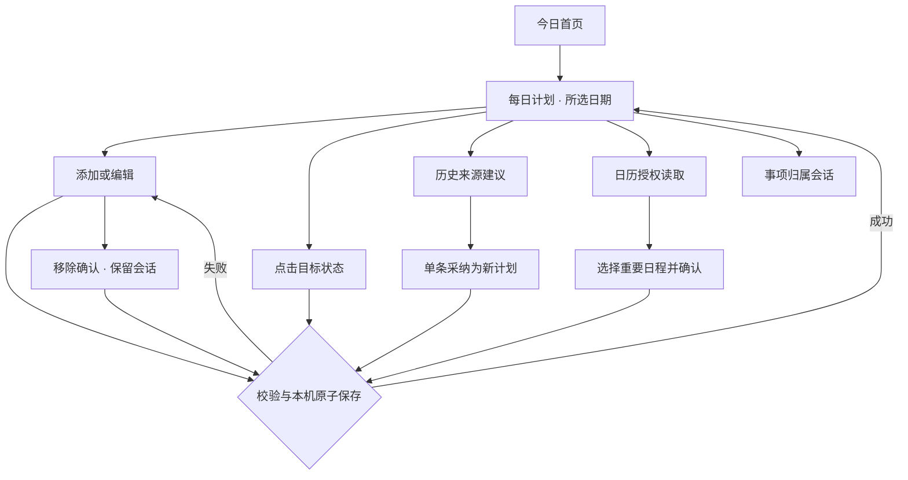

# 每日计划模块需求规格与设计

版本：1.0；日期：2026-10-03；适用：HarmonyOS 6.1.1 / API 24。

本轮依据用户指令完成模块设计并开发本机功能，不新增测试用例。设计承接 [V1.0 产品需求](../08-product-requirements-V1.0.md) V1-P01～P05 与 [前端设计](../09-frontend-design-V1.0.md)。新增字段与规则属于本轮实施方案，尚未取得逐页视觉验收；不将原型、编译或已有回归等同于设备验收。

文档维护约束（用户明确要求，2026-10-04）：后续每轮每日计划相关交互，持续将需求、反馈、约束和设计决策更新到本规格的对应章节，并在 [开发与交付记录](12-daily-plan-implementation.md) 按日期沉淀讨论结论、变更理由、实施与验证结果、未解决事项。纯讨论也应留痕；代码与文档在同一轮同步更新。明确区分待定、已实现与已验证状态，规则变更保留原因与日期。

## 1. 模块目标与场景

将“明天要做什么、今天推进到哪、未完成如何继续”组织为可追踪的每日行动。用户在晚间制定次日计划，在白天直接调整状态，结束后参考真实记录安排下一天。所有事项可以进入自己的需求会话；查看本机计划不依赖 Agent 在线。

| 场景 | 用户操作 | 结果 |
|---|---|---|
| 晚间安排 | 今日入口 → 每日计划 → 后一天 → 添加 | 按选定日期保存，默认待完成 |
| 当日执行 | 查看列表 → 点击已完成或进行中 | 直接设置目标状态，无需循环点击 |
| 临时变化 | 编辑事项 → 修改日期/项目/说明 | 原 ID 与会话保留，统计归属新日期 |
| 回顾历史 | 切换日期 → 筛选状态 | 查看指定日当前状态，避免自动把过期事项算失败 |
| 参考历史 | 查看来源依据 → 逐项采纳 | 目标日建立新事项，原始记录和计划不变 |
| 安排会议 | 读取所选日历 → 选择 → 确认加入 | 保留日历实例与时间快照，单独统计占用 |
| 移除事项 | 编辑 → 移除 → 就地确认 | 删除本机事项，保留关联会话为独立需求 |

## 2. 范围及交付状态

| 编号 | 需求 / 规则 | 本轮状态 |
|---|---|---|
| DP01 | 按自然日查看；前一天/今天/后一天及手输日期 | 已实现 |
| DP02 | 新增、编辑标题、说明、项目、重要标识、预计用时 | 已实现 |
| DP03 | 待完成/进行中/已完成；支持直接完成与重新打开 | 已实现 |
| DP04 | 全部/各状态筛选；重要事项优先 | 已实现 |
| DP05 | 手工事务改期；保持 ID、状态和会话 | 已实现 |
| DP06 | 移除二次确认；会话和日历原事件保留 | 已实现 |
| DP07 | 日历按选定日期读取、选择、确认、实例去重 | 已实现；权限及跨日设备表现待验证 |
| DP08 | 日历时间占用与事务完成统计分离 | 已实现；全天不折算分钟 |
| DP09 | 前 7 天未完成计划、新增待办构成本机建议 | 已实现；明确标识规则来源 |
| DP10 | 用户逐项采纳；来源可追溯、同源同日去重 | 已实现 |
| DP11 | 计划与需求会话关联并恢复 | 沿用；远端持久化待协议 |
| DP12 | 配置晚间提醒时间、每日/工作日、取消 | 沿用普通系统提醒；新增制定计划入口 |
| DP13 | 锁屏强提醒、点击直达次日制定页 | 已设计目标；平台接入与设备验证未完成 |
| DP14 | Hermes 个性化建议与记录/精力反馈 | 已设计契约；未接入远端 |
| DP15 | 本机保存、断网可用、按服务器隔离 | 沿用原子存储；远端同步未实现 |

DP13～DP15 的未接入能力仍在 V1.0 范围内。不能凭现有文本聊天协议模拟服务端同步、提醒直达或建议生成成功。

## 3. 数据与字段约束

自然日使用设备当地日期 `YYYY-MM-DD`，日历区间为当地零点至次日零点；跨月、闰年和夏令时按日期运算，不按固定 24 小时加减。完成状态由用户确认，不按当前时间自动推导。

| 字段 | 规格 | 默认 / 行为 |
|---|---|---|
| id | 不可变唯一标识 | 新增生成；编辑与改期保留 |
| date | 有效自然日，精确到天 | 新增取列表日期；可查看过去或未来 |
| title | 去除首尾空白，1～200 字符 | 必填，不允许空白；超长拒绝，不截断 |
| status | todo / doing / done | 新增 todo；不根据会话回复自动完成 |
| projectId | 当前空间项目 ID 或空串 | 独立事项；无效项目拒绝保存 |
| priority | normal / important，可缺省 | 旧数据缺省 normal；重要项排在前面 |
| minutes | 可选整数 1～1440；存储 0 表示未填写 | 不代表实际耗时；不参与完成率加权 |
| note | 可选，最多 4000 字符 | 支持换行；列表完整展示，随内容增高 |
| calendarSource | 日历实例 key、原标题、起止时间、全天标志 | 来源快照；不写回系统日历 |
| suggestionKey | plan/id 或 record/id | 同一来源同一目标日不可重复采纳 |
| suggestionReason | 来源日期、来源种类、状态或补记、来源 ID | 保存采纳时依据；以后不随来源更新 |

延续 Workspace version=2，仅新增可选字段，旧记录无需强制迁移。校验拒绝损坏字段；遇到损坏文件不会自动清空重建。

## 4. 业务规则

### 4.1 统计和排序

- 事务完成/进行中/待完成：仅统计选定日期、当前空间、无 `calendarSource` 的计划，不受界面筛选影响。
- 无事务时展示 0 项，不显示虚构完成率；本轮采用数量而非效率评分。
- 日历占用：仅统计已确认加入计划的非全天事项，将时间裁剪到选定日边界，合并重叠后按分钟四舍五入。不代表系统日历全部占用，也不代表有效工作时长。
- 全天日历单独文字标明；会议状态可手动记录，但不纳入事务完成数。
- 重要事项优先，同优先级保持原列表顺序；不提供未确认的智能排序或自动挪期。
- 首页前三项展示原计划列表顺序；完整列表提供优先级排序与筛选。

### 4.2 修改、改期与移除

手工事务修改在保存成功后生效，状态不重置。改期后原日期不再计数，新日期计数；已完成事项改期仍保留完成状态。编辑标题不改写既有会话名称或历史消息。

日历事项可以修改本机标题、项目、重要性、预计用时和说明；禁止直接改日期。日历快照不随着系统日历修改自动更新。本轮没有事件更新合并协议；需用户在系统日历修改后重新读取并检查，必要时先移除旧副本再导入。移除本机副本不删除系统事件。

移除确认在编辑页展开，说明关联会话保留。确认成功后，原 `ownerKind=plan` 会话转为 independent；原计划来源链接删除，消息及会话 ID 保留。已经移入项目的会话保持项目归属。删除事项不会自动撤销普通系统提醒。

### 4.3 建议与采纳

本机建议不是 AI 分析：查询目标日期之前 7 个自然日（不含目标日）的未完成/进行中非日历计划，以及记录的 nextTodo；记录按事件起始日期归属，未填写事件区间时按保存日期，补记显示标识。未完成事务按计划日倒序，新增待办按记录保存时间倒序。

每条建议显示标题与依据，由用户单条点击“采纳到日期”。采纳新建 todo，未完成来源计划继承项目，记录待办默认独立；保留来源快照。原计划不自动完成、不自动移动。不同来源即使同名也允许采纳；同一来源目标日已有采纳项则不再列出。来源被修改后采纳读取当前数据；来源已完成/移出时间窗口/删除时拒绝过期采纳。删除目标日采纳项后允许再采纳。

记录待办超过 200 字不直接变成计划；界面明确提示先拆分，避免截断。采纳不继承重要性、预计用时和说明，可在新事项编辑页补充。每次采纳即时本机保存，不批量提交、不自动上传。

### 4.4 日历授权与分享

2026-10-06 异常边界补充（问题8已实现）：授权窗口暂不可用、查询时权限拒绝/撤销、能力不支持、日历服务错误均显式失败并保留调用阶段及数值错误码，不返回部分日历或伪造空结果，不自动重试。日志不保存日历正文。此变更不调整查询日期、来源标识、去重或导入规则；系统权限拒绝/撤销的真机交互仍待专项验收。

只在点击读取后申请 READ_WHOLE_CALENDAR；拒绝权限显示就地错误及系统设置恢复路径，手工计划继续可用。切换日期清空选择，隐藏日期不匹配的日历快照。并发处理期间按钮禁用；旧日期读取返回后仍按请求日期标记，不能错导入当前日期。

实例 key 沿用“日历 ID/事件 ID/实例起始时间”，当前空间去重。导入使用空 projectId，后续可单独编辑所属项目。重复选中项跳过。一次导入任何数据校验或写入失败时，全部不提交，选择保留。

日历读取与向 Hermes 分享独立授权。只有今日读取可以填充现有“分享今日日历”上下文；其他日期只进入本机列表，不误当今日上下文。所有快照均非实时同步，显示采集时间。刷新前清空旧快照，失败不将旧数据显示为已刷新。

2026-10-04 用户反馈：刷新日历出现两条相同记录，要求先解释原因、不修改代码。当前按实例 key 去重，不按标题和时间合并；不同日历 ID 或事件 ID 的记录可能显示为相同标题与时间，列表尚未展示这些来源差异。也需区分“日历候选列表内两条”与“已导入计划和日历候选各一条”。尚未取得当次两条记录的标识与所在分区，具体根因待核实；不据此变更去重规则或直接合并同名事项。分析见 [问题记录](../testing/10-test_record.md) 问题7。

## 5. 前端页面设计

视觉评审资料：[每日计划交互设计稿](../design/daily-plan/index.html)，使用明确标识的示例数据。

### 5.1 每日计划列表

手机单列，内容区域最大 720vp；16vp 边距，卡片内边距 16vp/圆角16vp，列表间12vp，分区间24vp。沿用米白/葱青及深色语义色，不散落硬编码颜色。

从上到下：返回 → 标题和本机说明 → 前一天/今天/后一天 → 查看日期 → 事务状态摘要 → 已加入日历占用说明 → 主操作“添加计划” → 全部/待完成/进行中/已完成 → 事项卡片 → 日历读取与导入 → 历史建议 → 查看记录汇总 → 晚间提醒入口 → 远端能力状态。

卡片层级：18fp 标题，14fp 日期与状态，14fp 来源/项目/重要性/预计用时，日历时间，16fp 说明，14fp 采纳依据；底部三种状态按键、编辑/改期、继续会话。重要状态同时用文字和勾选形状表示，不只靠颜色。状态按钮触控高至少48vp；长标题/说明换行。

### 5.2 编辑页

独立滚动页面，添加与编辑共用：日期、标题、重要开关、预计用时、说明、项目选择、保存。编辑时追加移除入口；展开确认后显示影响范围和确认/保留按钮。日历事项显示不能改期的说明，领域校验同时拒绝日期变更。

输入失败保留所有字段，只在本机原子保存成功后清空并返回。返回列表再进入同一事项恢复未提交输入；新建草稿返回后再次添加保留文字，但日期跟随本次列表选择。进入另一个事项编辑会替换编辑缓冲；草稿仅在当前应用进程保留，应用被系统终止不保证恢复。切换服务器按现有 formDrafts 分空间保存；不跨空间带出内容。

键盘沿用 KeyboardAvoidance，输入区可滚动，底部导航随实际键盘隐藏。全部文字使用系统字体与 fp；长文本不裁剪。输入预计用时仍使用文本输入，保存时校验整数，不将错误数字静默转换。

### 5.3 状态与反馈

| 状态 | 界面和恢复 |
|---|---|
| 当日无计划 | 明确空说明，给添加与建议采纳入口 |
| 筛选无结果 | “当前状态下没有事项”，保留所有筛选按钮 |
| 日期无效 | 就地错误，隐藏日期依赖的添加/列表/导入 |
| 保存中 | 禁用提交与可修改输入，防重复提交 |
| 保存失败 | Toast 说明错误，列表不变，输入/选择保留 |
| 日历未读取 | 显示所选日期尚未读取 |
| 日历返回为空 | 显示日期和真实 0 条；与未读取、权限错误区别 |
| 日历读取失败 | 就地错误及 Toast，可重新授权刷新 |
| 暂无建议 | 说明暂无可采纳建议及超长待办处理方式 |
| 远端未接入 | 显示 AI/同步状态，不生成假建议/同步时间 |

交互示意：

### 5.4 V2.0 卡片化提前设计 · 2026-10-06

2026-10-09 视觉补充：V2.0 主浏览页底部导航采用居中悬浮胶囊，入口内容不变，详见[14设计约束](../14-frontend-design-V2.0.md)。今日计划与其他滚动内容需预留导航高度、底部间距和安全区，确保末项可滚至胶囊上方；完成/取消完成反馈置于胶囊上方，详情遮罩覆盖导航。用户于2026-10-09确认当前悬浮胶囊预览符合预期，具体视觉参数作为V2.0已确认设计基线；不改变事项状态和会话规则，尚未实施或设备验收。

用户明确要求全页面卡片化、减少常驻按钮，计划每项用独立 box 完成控件，具体内容由 dialog 等详情卡承载；先完成设计，不修改应用代码。完整评审稿见 [14 · 前端设计 V2.0](../14-frontend-design-V2.0.md)，对应 [V2.0 可视稿](../design/V2.0/index.html) 中“每日计划 / 制定明日计划”场景。

本轮提案：列表仅留方形完成框、标题、必要项目/时间与状态；点正文打开详情，点完成框直接设置 done，不互相触发。进行中在详情明确选择；取消勾选建议恢复 todo，撤销恢复变更前状态。完整说明、来源、编辑/改期、移除及会话入口放进详情；日历、历史建议、记录与提醒通过计划工具进入专用卡片。长表单扩展成大尺寸 sheet 或独立页，未保存关闭处理草稿。

约束：保存成功后才确认状态；失败保留旧值并提示。todo/doing/done、自然日、统计分离、标题/说明/分钟校验、日历实例去重、单条采纳与原子保存、改期保留 ID 和移除保留会话均继续沿用。日历卡默认不显示事务完成框，同名日程需展示来源差异，不据此宣称问题7根因或修复已确认。

状态区分：用户已提出卡片化方向；2026-10-06 用户明确确认取消勾选回到“待完成”（todo），以及先打开对象详情、再进入关联需求会话。两项作为 V2.0 有效设计规则；其余撤销细节、按钮位置和呈现细节仍待评审。第5.1～5.3节仍为 V1.0 当前方案，不被预研覆盖；V2.0 未实现、未设备验收，也不延期原 V1.0 远端与强提醒范围。

## 6. 代码职责与持久化

| 文件 | 职责 |
|---|---|
| core/Workspace.ts | 计划保存/移除、字段校验、自然日移动、本机建议与采纳去重、占用区间合并、事务计数 |
| pages/Index.ets | 日期/筛选/编辑草稿、提交锁、失败反馈、列表/编辑/日历/建议/提醒路由 |
| components/DailyPlanCard.ets | @Prop 驱动的卡片，状态及编辑/会话事件 |
| services/NativeData.ets | 按指定自然日查询系统日历；缺省今日兼容旧调用 |
| services/WorkspaceRepository.ets | 沿用快照校验、临时文件、fsync、原子替换 |

每次 mutation：copyWorkspace → 在当前空间应用规则 → validateWorkspace → repository.save → 替换 @State data。失败不发布快照。卡片用 ID 从最新 @State 数据查找再传给 @Prop 组件，避免同 ID 更新后继续展示旧对象。不要从会话文字推断用户已经完成任务。

## 7. 远端与强提醒接入设计

### 7.1 架构评审约束 · 2026-10-06

用户明确要求本阶段只解析代码与形成架构文档，不修改代码；每个需求阶段需确认方案并形成完整设计。总体依据见 [架构设计](../03-architecture.md) 第7～10节，现有本机规则不变。

当前代码事实：建议为本机前7日规则；计划无revision/删除墓碑；关联会话没有向远端传递needId；日历是设备来源快照；普通提醒的reminderId属于本机系统注册，不是远端任务ID。因此不能把这些现有字段直接当成Hermes同步/建议/调度协议。

后端对齐前置条件：核实实际Hermes版本、持久身份/会话、业务对象同步、结构化建议及调度能力。此前本节列出的字段仍是所需语义，不是已部署契约。现有serverKey基于地址，未来请求的用户/空间身份必须与后端认证主体映射；跨设备不能仅凭日历本机实例key去重，也不能同步reminderId作为另一设备的有效注册。

已确认方向（2026-10-06后续回复）：优先复用Hermes原生能力，缺口再评审适配边界。以下具体契约仍待确认：计划远端变更需修订与冲突处理，建议需获准的来源及可查询采纳记录，周期调度需时区、漏跑与去重策略。计划页提醒直达仍依赖冷/热启动参数和设备权限核验。以上未实现、未联调，不改变V1-P03/P04等V1.0范围，也不新增页面规则。

用户随后指定Hermes v0.17.0。官方对应版本已发现会话、运行与调度基础，静态证据见 [03第11节](../03-architecture.md)。计划对象同步、建议来源与采纳、日报结果写入仍需业务契约；服务端调度不替代鸿蒙强提醒。用户后续已确认官方原版及API Server启用；Skill配置和实际接口响应仍待联调，本轮未改代码。

本轮共享架构候选见 [03第12节](../03-architecture.md)：同机独立业务服务持有计划修订/墓碑、同步回执、建议与日报关联；Hermes负责Agent执行和调度，手机负责本机副本与系统提醒。计划同步与模型上下文分享分别授权，日报生成、外部写入与通知送达分别确认。独立服务部署及字段契约尚待用户批准；现有本机规则、页面与数据版本未变。

### 7.2 既有待对齐契约

以下为待对齐协议，不是当前 Hermes 已有端点：

- 建议请求携带 serverKey、目标日期、明确获准的来源 ID/范围与请求 ID。响应需要 suggestionId、标题、来源引用及理由、生成时间、模型标识；无来源的建议标明推断，不冒充历史事实。用户可以拒绝或编辑后采纳。
- 同步事件需 entityId、revision、serverTime、origin、requestId 与删除墓碑；本地保存后保持待同步，只有服务端确认才更新同步状态。离线操作队列与幂等提交待设计到真实服务端；冲突提供本机/远端对照，不静默覆盖。
- 晚间提醒配置建议包含 enabled/time/weekdays/目标次日入口；与周期记录提醒独立。设备通知与闹钟能力、权限、Want 参数或系统支持的跳转机制须先核验，再连接 EntryAbility 的冷/热启动路径。到达计划页时选设备当地次日，不自动创建计划。
- 当前普通系统提醒只打开应用，尚无模块直达；不承诺突破免打扰、静音或锁屏限制。更改提醒注册与本机保存须做回滚；取消失败保留可重试配置。多端不要同时自动注册重复提醒。
- 没有已核验接口前不新增假 HTTP 路径或自动调度；真实协议联调后补齐服务适配及真机证据。

## 8. 本轮验证与后续交付

遵照用户指令不新增测试用例。已有服务测试的模块加载依赖增加 Workspace，适配 NativeData 的运行时日期校验导入，原测试行为不变。执行记录见 [模块开发记录](12-daily-plan-implementation.md) 与 [发布记录](../05-release.md)。

后续依赖：真实 Hermes 接口；通知直达参数/设备权限能力；目标真机的跨日、锁屏、日历与大字号表现。以上完成前，本模块可交付本机每日计划闭环，但不能标记 V1-P03 强提醒、V1-P04 远端个性化建议、业务同步全部完成。

### 2026-10-07 · 独立业务副本实施边界

用户确认独立业务服务先本地实现与测试。新增业务预览入口支持今日计划离线创建、显式同步、删除墓碑与冲突选择；此入口使用独立业务副本，不替代当前每日计划页。同步字段仅含用户编辑的最小业务投影，不上传 calendarSource、提醒注册 ID、设备快照或聊天历史。旧每日计划迁移、关联需求删除规则的服务端事务以及完整原页面接入仍待实现。详情见架构第13节；本地测试不代表远端或设备验收。

2026-10-07真实联调补充：独立业务HTTP的合成计划提交/拉取通过，并验证业务服务到真实Hermes的会话链路；未接通旧每日计划页或真实日历来源，不改变迁移与跨实体关联待办。

### 2026-10-09 · 项目关联边界

项目模块新增类型、生命周期与阶段成果，仍通过PlanItem.projectId复用每日事项。里程碑不自动生成每日事项，项目达成不自动完成事项；归档项目也不删除或取消既有事项。项目详情可进入现有事项编辑器并预选项目；日期/保存规则保持。项目模块当前规格见[17](17-project-spec.md)。

### V2.0 项目行动入口补充 · 2026-10-11

项目卡片化方案见[17第9节](17-project-spec.md)。用户确认项目新增每日事项经统一＋菜单，预选当前项目归属，保留每日计划原字段与校验；行动分区继续使用独立完成框，正文先详情再关联会话。今日页仅显示项目简要进展，不增加项目操作按钮。项目及今日摘要预览中的毛玻璃材质已于2026-10-11获用户确认，仅影响视觉，不改变事务状态、统计或保存行为；每日计划其他页面尚待适配，本轮未改生产代码。

### 事项会话视觉统一 · 2026-10-11

事项详情后的关联会话采用[14第14节](../14-frontend-design-V2.0.md)左右布局：Hermes左、用户右，极简顶栏与输入区；取消会话内底部导航，返回原事项详情。仅视觉与控件收纳提案，不改变完成框、needId关联、上下文授权和手动发送规则，具体样式待确认。
