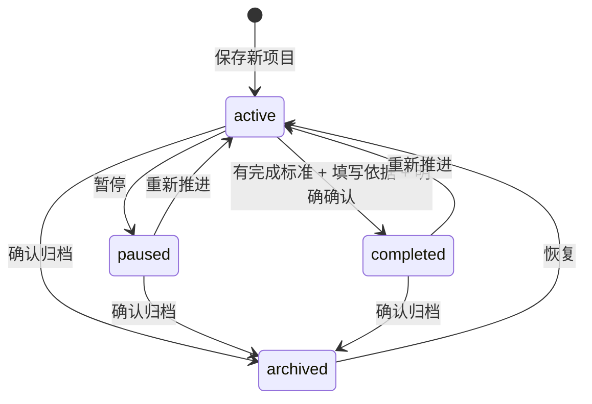

# 项目模块 · 需求规格与交互设计

日期：2026-10-09。版本：0.1。依据：用户本轮明确要求按项目管理个人学习、健身、效能提升计划，通过持续与 Hermes 交互达成目标，并为未来远程多 Agent 软件构建建立入口。

本文区分**用户明确要求、实施设计、未来协议、已实现状态**。本轮授权设计与代码开发；细节为本轮实施方案，不视为用户逐项确认或设备验收。早期开发不新增测试的约束已由 2026-10-09 用例补充与 2026-10-11 V1 实施更新；当前运行完整 Harness 与行为回归。交付状态见 [18 实施记录](18-project-implementation.md)，可交互示例见 [项目原型](../design/projects/index.html)。

## 1. 定位与范围

项目是一个持续推进的目标容器，拥有目标、完成标准、下一步、阶段成果、行动与复盘。学习计划、健身计划、效能提升计划都是项目；项目不限于软件仓库，也不等于单日待办清单。Hermes 是持续讨论与辅助推进的伙伴。

| 层级 | 内容 | 本轮交付边界 |
|---|---|---|
| 个人目标项目 | 学习、健身、效能提升及其他目标 | 本机结构化管理、关联任务、项目会话入口 |
| 软件构建项目 | 用手机描述需求、评审方案、查看远程执行与成果 | 本轮实现项目类型与需求讨论；编排、执行与部署为未来接入 |
| 公共骨架 | 目标、完成标准、阶段、行动、复盘、会话 | 类型共享骨架，不强迫共用“成功率” |
| 专属数据 | 训练量、知识掌握、专注时长、代码变更 | 本轮不虚构专属统计，不接健康接口，不执行远程命令 |

原 V1.0 总体远程协作愿景保留。本轮按用户“未来”表述明确为后续阶段，不能用本机前端交付宣称完整 V1.0 达成。Agent 托管是托管偏好，与执行、跨项目写入、部署授权分开。

## 2. 使用场景与目标定义

| 类型 | 目标例子（设计示例） | 完成标准例子 | Hermes 协作 | 可核对证据 |
|---|---|---|---|---|
| 学习成长 | 掌握嵌入式驱动基础 | 独立完成 GPIO/UART 实践并解释关键机制 | 澄清基础→学习路线→疑难讨论→阶段回顾 | 实验记录、解释、练习成果 |
| 健身运动 | 建立持续运动习惯 | 在自主设定周期内完成约定训练安排 | 讨论时间约束、回顾执行、调整安排 | 用户手工记录；不伪造健康来源 |
| 效能提升 | 减少工作切换 | 在约定周期内记录并回顾专注安排 | 找到阻碍、提出小实验、对照实际记录 | 复盘与行动记录，不制造效率评分 |
| 软件构建 | 远程完成一个应用功能 | 变更可审查、验证符合约定、用户验收 | 澄清需求→方案→分工→构建→评审 | 后续真实 commit、检查与制品回执 |

例子不自动写入真实应用。不给用户设定默认健康指标、目标期限或强制计划；类型仅分类，不构成健康建议。

## 3. 信息模型与字段

### 3.1 项目 Project

| 字段 | 规则 | 本轮存储 |
|---|---|---|
| id | 稳定唯一标识；改名不改变关联 | 复用 newId |
| name | 必填，去首尾空白，1–100 字符 | 已有 |
| kind | learning / fitness / effectiveness / software / other | 新增可选字段；旧项目显示 other |
| goal | 必填，1–4000 字符，说明想达成什么 | 已有 |
| criteria | 新建与编辑保存必填，1–4000 字符；描述可观察的成功条件 | 新增可选字段；旧数据不自动推断 |
| targetDate | 选填，有效 YYYY-MM-DD；允许过去日期用于补录 | 新增；未填写不显示虚构期限 |
| managedBy | manual / agent；默认 manual | 已有；不授予权限 |
| status | active / paused / completed / archived | 新增可选字段；旧项目按 active 展示 |
| nextStep | 选填，最多 4000 字符，当前最值得做的一步 | 已有；保存时校验 |
| milestones | 0–100 个阶段成果 | 新增可选数组 |
| reviews | 追加的复盘 / 成果 / 达成依据记录 | 新增可选数组 |

目标与完成标准分开：目标表达意图，标准用于判断结果。新建后并不强制立即联网或生成任务。项目可离线创建，明确“保存到本机，尚未同步”。

### 3.2 里程碑与复盘

里程碑字段：id、title（1–200 字符）、dueDate（可空日期）、done（布尔）。完成后可重新打开；不自动更改项目状态，不自动新增每日任务。本轮支持添加与完成切换，名称/日期修改、排序与删除留待后续，避免扩展无审计的破坏性操作。

复盘字段：id、text（1–4000 字符）、createdAt（实际保存时间）。倒序展示，记录实际结果、证据描述、阻碍、决策和后续调整。本轮为自由文本，追加后保留历史；不支持附件上传、外链打开、历史改写和删除。达成依据最多 3900 字符，系统添加“目标达成依据”标识后写入复盘。

### 3.3 关联与统计

- `PlanItem.projectId` 是任务与项目的唯一关联；项目详情展示关联事项，复用现有任务编辑与状态逻辑。
- 需求通过 `Need.ownerKind='project'` 与 `ownerId` 关联。每个项目可有多个需求，既有需求继续原会话，不复制历史。
- “与 Hermes 推进目标”生成一个可编辑的**新需求草稿**，用户建立会话后再确认发送；继续旧讨论使用“继续会话”。二者明确区分。
- 项目卡片任务数仅统计本机关联非日历事务；里程碑计数与任务计数分开。没有任务即显示 0/0 项任务，不换算 0% 或完成率；全部任务完成也不代表目标已达成。
- 项目归档不自动取消任务、系统提醒、会话或远端运行。本轮没有删除项目入口。

## 4. 功能需求与验收口径

下表是功能要求，不是新增测试用例，也不代表已经验收。

| 编号 | 功能要求 | 可观察结果 |
|---|---|---|
| PRJ-01 | 列表检索和状态筛选 | 搜索名称/目标；进行中、暂停、达成、归档、全部；默认进行中 |
| PRJ-02 | 新建项目 | 必填校验，失败保留输入；成功进入详情 |
| PRJ-03 | 编辑项目 | 保留 ID、已有任务与会话、里程碑和复盘 |
| PRJ-04 | 目标拆解 | 展示/添加阶段成果，独立完成或重开 |
| PRJ-05 | 执行动作 | 项目内新建每日事项并预选归属；编辑沿用原事项 ID |
| PRJ-06 | Hermes 讨论 | 用户可预览摘要，建立需求，手动发送；旧会话可恢复 |
| PRJ-07 | 复盘沉淀 | 手动添加实际结果/阻碍/下一步，时间可查 |
| PRJ-08 | 目标达成 | 用户对照标准填写依据，确认后转 completed；不自动判定 |
| PRJ-09 | 暂停/恢复/归档 | 可恢复；归档前说明影响，保留关联对象 |
| PRJ-10 | 离线与隔离 | 写入本机当前服务器空间；切换空间不混项目或草稿 |
| PRJ-11 | 软件构建能力边界 | 显示未接入说明；无虚假运行、构建/部署成功按钮 |
| PRJ-12 | 可恢复输入 | 页面来回与失败保留本次进程草稿；杀进程前未保存草稿不保证恢复 |

## 5. 页面与交互

### 5.1 项目列表

沿用“今日 / 项目 / 阅读 / 我的”。项目页依次为：标题与解释、新建项目、搜索、状态筛选、项目卡片、独立需求。卡片显示名称、类型、状态、目标、托管偏好、本机任务完成数与下一步。点击进入详情；首页仅摘要展示进行中项目。

未建立项目：说明可从个人目标开始，保留新建入口。筛选无匹配：提示切换条件，不暗示数据丢失。已有数据加载失败沿用整个工作区的写保护，不能用空数组覆盖原文件。

### 5.2 新建 / 编辑

单列可滚动表单：名称→类型→目标→完成标准→目标日期→下一步→托管方式→保存。类型五选一，默认学习成长；托管按钮清楚显示当前选择与切换方向。保存期间禁用表单和提交，失败不清空输入。

编辑原地展开，返回概览保留草稿，只有保存才修改正式数据；离开页面不自动保存。创建成功进入新项目详情。输入通过标准 ArkUI 控件处理键盘；大字号、320vp 与读屏仍需设备核验。

### 5.3 详情

首屏：项目名称、类型与状态，概览 / 里程碑 / 复盘分区。

- 概览：目标、完成标准、目标日期、下一步、本机状态、Hermes 入口、编辑、生命周期操作。
- 里程碑：阶段成果与目标日期、当前完成状态、添加表单。状态同时用文字和勾选提示，不能只依赖绿色。
- 复盘：新记录表单、倒序历史；空状态提示从实际结果开始。
- 详情下方共用：需求会话、任务、远端能力说明。任务沿用每日计划组件；原会话仍可继续。
- 软件类型额外显示未来执行流程与“尚未接入”，不能将其理解为已经运行。

布局使用现有葱青与米白语义色，深色成对资源，16vp 边距/卡片内边距，16vp 圆角，正文16fp、辅助14fp，触控区至少48vp。原型提供宽屏说明栏与手机画布；原生仍为单列滚动。

### 5.4 项目状态

本轮归档项目的项目字段、里程碑、复盘入口只读；关联任务/会话拥有各自生命周期，仍允许处理。暂停不等于停止远端 Agent，归档不等于删除数据。恢复归档统一为进行中，不恢复推断出的旧状态。completed 是用户声明达成，不代表外部认证。

### 5.5 与 Hermes 持续交互

摘要包含当前项目名称、类型、状态、目标、完成标准、日期、下一步、里程碑及最近三条复盘；不自动读取其他项目、健康数据或日历。2026-10-11 增加复盘到可编辑预览，只有用户明确发送后才分享。过长摘要显式截短，用户在发送前可改写。快照不会随项目后续编辑自动改变旧消息。

点击项目入口仅准备内容，不触发网络请求。现有文本接口的最近40条消息与跨会话6条引用规则保持。AI 的建议需要用户手动转成正式行动，本轮不解析模型文本自动改项目。会话历史的远端恢复仍以实际业务协议接入为准。

## 6. 未来软件项目与 multi-agent 设计（协议草案，未实现）

### 6.1 用户流程与页面

1. 项目概览设置软件目标和验收标准，选择受允许的远程仓库/分支/环境。
2. Hermes 澄清需求，返回版本化方案、预计改动、Agent 分工、检查计划和资源预算。
3. “方案评审”展示本次执行范围、明确禁止项、数据范围；用户确认具体方案版本后创建运行。
4. “运行详情”展示任务 DAG、Agent 当前角色、依赖、阶段、最近事件、待处理事项；默认摘要，日志按需展开。
5. “成果评审”分别展示 diff/commit、测试/构建结果、制品、未解决问题；用户可要求修改或验收。
6. 如需部署，单独呈现环境、版本、影响、回滚目标并确认；部署完成必须来自服务端回执。项目达成仍独立判断。

首批角色建议：协调 Agent（Hermes）、需求/设计、实现、验证/评审。角色是执行端能力，不能在手机通过模拟文字伪造。首批适配器、并发限制、耗时/费用预算、超时与资源回收机制待执行端选型后确认。

### 6.2 运行对象

| 对象 | 最小字段与约束 |
|---|---|
| ExecutionPlan | planId、projectId、revision、目标、范围、仓库基准commit、任务依赖、权限、预算 |
| Run | runId、projectId、needId、approvedPlanRevision、operationId、status、createdAt、updatedAt |
| AgentTask | taskId、runId、role、dependsOn、status、attempt、隔离工作区标识 |
| RunEvent | eventId、runId、sequence、timestamp、type、taskId、脱敏摘要 |
| Approval | approvalId、runId、action、scopeDigest、revision、expiresAt、decision |
| Artifact | artifactId、runId、kind、revision/hash、受鉴权访问地址、产生任务、检查状态 |
| Deployment | deploymentId、runId、目标环境、版本、独立审批、结果、rollbackTarget |

暂定运行状态：queued / running / waiting_user / succeeded / failed / cancel_requested / cancelled。网络断开是**观测状态**，不能把运行改为失败/取消。客户端停止等待不代表任务已停止。

### 6.3 接口与恢复约定

- 命令草案：提交已确认方案、查询原 operationId、获取运行快照、从事件游标续拉、提交审批、请求取消、请求部署。路径待 backend 协议版本确定，不在客户端提前硬编码假 API。
- 持久化意图后再发送，服务端以 operationId 幂等受理；超时先查询同一操作，不能新生成 ID 盲目重发。
- 每个运行事件按 sequence 去重与排序；检测缺口后拉快照，提交快照与游标原子落盘。重复事件不重复产生通知或审批。
- 方案、仓库基准或权限变化时使旧审批失效；审批绑定动作、范围摘要、版本与有效期。恢复连接不能自动批准待办。
- 同时运行的 Agent 使用隔离工作区；由协调者整合与解决冲突，不直接覆盖用户工作区。日志和制品不承载原始凭据。
- 服务端负责鉴权、执行隔离、权限校验和资源限制，前端禁用按钮不能替代服务端控制。
- 手机显示最近收到事件的时间，后台不承诺持续在线；重新打开以快照和游标恢复。跨端冲突基于版本，不以最后写入静默覆盖。
- 当前独立业务预览已有意图与副本基础，但主项目页尚未迁移；不能据此宣称多 Agent 或远程构建已完成。

## 7. 数据、安全和失败规则

项目仍属于当前 `Space.serverKey`，使用现有原子写文件提交；扩展字段可选以兼容既存 version=2 数据。读取时校验类型、日期、长度、ID 唯一性及复盘时间；新建/编辑要求标准，旧数据允许暂缺标准。未识别的状态/类型拒绝加载，避免悄悄丢弃损坏数据。

- 本地保存成功后才替换界面正式数据；失败保留旧值与草稿。
- Token 沿用 Asset Store，不进入项目、日志、草稿或备份。
- 草稿按服务器 + 项目ID隔离，只在当前进程保留，不承诺杀进程恢复。
- 不自动修改手工 Vault，不把 Agent 托管勾选当作执行授权。
- 日期表示目标，不自动改状态，不自动发提醒；健康数据接入需要单独授权。
- 项目上下文分享经过可见的草稿与发送动作；既有日历/设备/跨会话授权机制不变。

## 8. 实施阶段与未决事项

| 阶段 | 内容 | 状态 |
|---|---|---|
| P1 本机闭环 | 项目字段、列表、详情、里程碑、复盘、关联任务与会话 | 本轮实现，验证见18 |
| P2 服务端项目副本 | 项目/阶段/复盘实体协议、同步冲突、服务端会话恢复 | 尚待接入 |
| P3 建议采纳 | Hermes 结构化建议、逐项确认、版本冲突校验 | 未实现 |
| P4 远程构建 | 工作区、执行计划、Agent任务、事件、审批、制品 | 本轮设计草案 |
| P5 部署与知识沉淀 | 独立部署授权、回滚、PARA归档和来源追踪 | 本轮设计边界 |

后续需确定：首批软件执行器与服务器环境；目标是否需要多项定量指标；里程碑编辑/删除审计；周期复盘提醒；项目与阅读/健康的显式关联方式。以上不阻断本轮本机实现，不暗中扩大成自动执行。

## 9. V2.0 卡片化与毛玻璃评审 · 2026-10-11

本节为 V2.0 提前设计，保留第1–8节的数据、校验、安全和能力边界；不覆盖第5节对应的当前实现。用户要求结合本规格重新设计项目相关前端，保持信息集中页简洁、减少按钮并逐项确认，尝试整体毛玻璃效果。本轮不修改应用代码。

**已确认的按钮方案**：详情主区域只保留一个“与 Hermes 推进”入口；新增事项、阶段成果、复盘经顶部“＋”菜单选择；编辑、暂停、达成、归档收进“更多”。已有需求卡片可直接继续原会话，不自动选择会话或发送。归档等状态下按下表替换/隐藏不适用动作。**视觉已确认（2026-10-11）**：用户看图并查看原型后反馈“符合预期”，本轮项目卡片布局及浅深色毛玻璃材质纳入V2.0设计基线。可视稿：[项目 V2.0](../design/V2.0/projects-glass.html)，与旧项目原型及全页面V2基线分开保存。

### 9.1 信息层级与页面地图

| 页面 | 常驻关键内容 | 进入详情后显示 / 操作 |
|---|---|---|
| 今日项目摘要 | 名称、下一步、阶段与本机任务两组计数；仅进行中项目 | 点卡进项目详情；无查看、编辑、聊天按钮排布 |
| 项目列表 | 顶部新建；搜索名称/目标；一个状态筛选器（默认进行中）；项目卡和独立需求入口 | 卡片展示名称、短目标、下一步、状态、阶段计数、本机任务计数；完整目标及托管偏好进详情 |
| 项目详情 · 概览 | 名称、类型/状态、本机保存/同步状态；目标与标准摘要卡、下一步卡、Hermes主动作、已有需求卡、阶段/复盘摘要 | 点目标卡读完整目标/标准/期限/托管偏好；点摘要到对应分区，不展示每一条记录 |
| 阶段分区 | 阶段标题、目标日期、完成状态；独立完成框 | 点正文读详情；不提供当前未支持的编辑、排序和删除 |
| 行动分区 | 本机关联非日历事项，标题、日期、完成框 | 正文打开事项详情，再进入关联会话；复用每日计划编辑及状态规则 |
| 复盘分区 | 时间、短摘要；倒序卡片 | 详情只读全文；经统一＋新增，不提供历史改写/删除 |
| 新建/编辑 | 必填名称、类型、目标、完成标准；选填安排折叠；一个保存动作 | 目标日期、下一步、托管偏好渐进展开；已填写可选值提供摘要，错误时自动展开定位 |
| 项目需求 | 旧会话卡继续；Hermes入口提供“继续已有需求 / 发起新需求” | 新需求预览可编辑摘要，建立会话后用户手动发送；无既有需求时直接打开新需求草稿 |
| 独立需求 | 无项目归属的需求卡，包括“漫无目的” | 保留原需求身份和历史，不能误跳到项目示例会话 |
| 软件项目 | 当前公共骨架＋“远程构建尚未接入”能力卡 | 查看未来流程；当前不放可执行的运行、部署按钮 |

详情使用概览 / 阶段 / 行动 / 复盘四个分区；需求会话在概览以卡片呈现。返回恢复来源、分区、筛选和滚动位置。简单只读详情使用短弹层，长内容可滚动；长表单/会话使用独立页，隐藏底部导航。弹层同时只开一层，并覆盖、隔离底层导航。

### 9.2 按钮与状态矩阵

| 状态 | 主动作 | 顶部＋ | 更多 |
|---|---|---|---|
| 进行中 active | 与 Hermes 推进 | 每日事项、阶段成果、复盘 | 编辑、暂停、标记达成、归档 |
| 已暂停 paused | 与 Hermes 推进（仅讨论，不自动恢复） | 同上；记录不改变项目状态 | 编辑、重新推进、归档 |
| 已达成 completed | 与 Hermes 推进（讨论后续） | 同上；追加不自动重开项目 | 编辑、重新推进、归档 |
| 已归档 archived | 恢复项目 | 隐藏项目级新增 | 恢复为进行中；项目字段/阶段/复盘只读 |

归档项目的既有任务和会话仍可从对应卡片处理。无关动作隐藏，保存/请求进行中的适用动作禁用并说明原因。达到阶段100项上限时，新增菜单的阶段入口禁用并提示原因，其他入口保留。

“标记达成”必须展示完整标准、填写达成依据（上限3900字符）并明确确认；旧项目缺标准先提示编辑补齐，不自动推断。归档确认展示不停止任务/提醒/会话/远端运行的影响。恢复统一回到active。按本规格状态图只向active暴露达成、暂停入口；已知实现状态机偏差见测试问题15，本稿不修改或掩盖该问题。

### 9.3 完成框、表单与失败恢复

- 阶段完成框独立于正文，取消回到未完成；不自动改变项目状态或创建每日事项。
- 每日事务完成框沿用V2已确认规则：勾选完成，取消回到待完成；正文先详情再会话。
- 新建项目保持名称1–100、目标/标准1–4000的原校验。日期可空，托管默认manual；保存失败保留草稿与旧数据，禁重复提交。里程碑、复盘保留第3节约束。
- 草稿仍按服务器＋项目隔离，仅当前进程保留；关闭编辑给保留草稿/放弃的明确选择，不因点击卡片而自动保存。项目切换不带出其他项目数据。
- 新需求摘要仍只含第5.5节允许字段，过长显式截短；上下文不会因毛玻璃或按钮精简而隐去来源和发送确认。
- 无项目展示一张空状态卡并复用顶部新建入口；搜索无结果保留搜索和筛选；读取失败显示错误和恢复入口，不能当空列表。离线可本机记录，连接相关动作给状态与连接入口；不能把网络离线显示为项目失败。
- 本地保存、远端确认分别显示；主项目页尚未接入的同步不显示演示成功。任务0/0、阶段0/0不换算百分比，不以事项全完成判定目标达成。

### 9.4 毛玻璃设计基线（2026-10-11 已确认）

沿用米白/葱青与深色成对色。整体采用同一材质层次，而非让每张卡片高度透明：内容卡浅色白色87%不透明度、深色surface 94%，轻模糊8px；悬浮胶囊和短详情为白色76% / 深色surface 88%，模糊24px。微弱1px轮廓与柔和阴影沿用已确认的胶囊基线。米白背景仅带低对比葱青色晕，不增加装饰图形、噪点或动画。

正文、输入区、长会话和报告保留实色阅读底；文字不降透明度。浅色正文#202B25、辅助#607267、强调#34785A；深色正文#EEF3EF、辅助#AAB8AF、强调#80C7A3。减少透明度偏好、模糊不支持或性能不足时降级为对应实色surface，信息及按钮位置不变。减少动态效果时不做材质转场；不能仅通过颜色表达选中、完成和失败。

以上是浏览器视觉参数，不是ArkUI API或性能承诺。系统安全区、大字号、低性能设备、实际背景下对比度与模糊性能待原生适配验证。用户已确认胶囊几何外形，本次材质更新已于2026-10-11获用户确认，替代本轮候选状态；其他模块的逐页适配仍未完成。

### 9.5 未来软件构建页面的卡片化

延续第6节协议草案：方案评审按目标/范围/基准版本/权限/预算分组，只有“确认此版本方案”一个主动作；运行页显示阶段、最近事件时间、待处理卡，原始日志按需展开；成果页按变更、检查、制品、未解决问题分卡，不将测试通过等同目标达成；部署必须单独核对环境、版本、影响与回滚并确认。断线保留最近快照并标记陈旧，取消请求显示等待服务端确认，不假装已停止。未接入前只展示能力说明，本轮不模拟已完成构建。

本轮原型只覆盖页面巡览、筛选、完成切换、状态菜单与需求选择等局部演示；不完整实现草稿恢复、新建持久化、真实会话身份或第6节远端协议。其余行为以规格为准。所有素材均示例，不能用浏览器演示作为生产验收证据。

## 10. 2026-10-11 · 当前 V1 业务实施边界

用户要求先完成 V1，§9 的 V2 毛玻璃与卡片布局暂不实现。现有普通列表、详情/表单及本机规则保留；“Agent 托管”在卡片说明为 Hermes 辅助推进且需确认，不是自动执行授权。

项目详情新增“项目持久会话与显式同步”。用户连接独立业务服务后，可确认当前项目业务字段加入持久 outbox，再手动同步；服务端支持类型、状态、完成标准、日期、里程碑和复盘的完整投影及 CAS 冲突。不会上传日历、凭据或旧聊天。远端副本暂不自动覆盖 Workspace 中的本机表单，两个保存边界分别显示。

项目持久会话使用稳定 project-ID Need，可编辑目标摘要含最近三条复盘，发送先保存意图，超时查询原操作而不重发。旧需求会话保留兼容路径，不能宣称已迁移；多 Agent、审批、远程构建和部署仍是未来范围。

生命周期严格沿用 §5.4：暂停/达成需先重新推进才能选择另一状态，重复达成不追加重复依据；缺标准明确提示“请先填写完成标准”。问题 15 修复与验证见 18 和测试记录。

### 9.6 统一左右会话候选 · 2026-10-11

项目所有需求会话（新需求、既有需求、未来成果讨论）沿用[14第14节](../14-frontend-design-V2.0.md)：Hermes左、用户右，正文均左对齐；极简顶栏与输入区，会话中隐藏底部导航。上下文选项按需展开，发送仍由用户决定，行动建议不自动执行。完整会话预览见[专用交互稿](../design/V2.0/conversations.html)。用户明确要求方向，具体气泡与控件样式待确认；不改变needId、会话恢复或当前后端能力。

## 2026-10-11 · V2 前端实施生效

本轮用户授权 dev 实施第9节卡片与毛玻璃方案，替代此前仅做V1的实施限制。列表检索加单一状态筛选；详情分概览/里程碑/行动/复盘；统一＋按对象类型分流，更多承载编辑、同步与生命周期确认。目标编辑必填与可选字段分层，已有每日行动与持久需求保持关联；归档只读目标不取消既有行动。未实现的远程Agent与部署继续明确能力边界。验证见 [21](../21-frontend-v2-implementation.md)。
